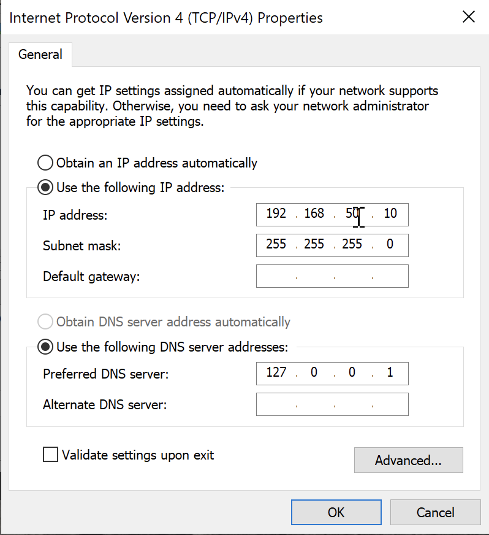
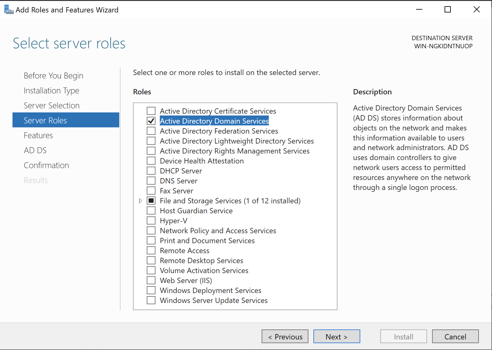
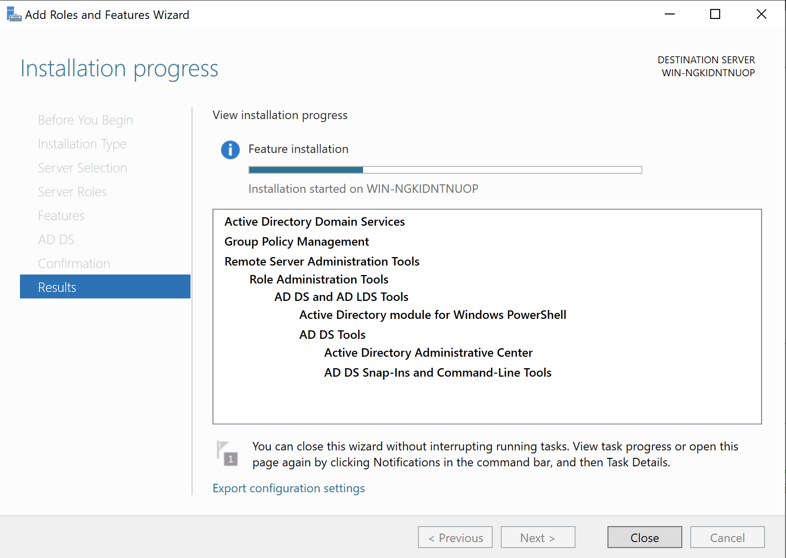
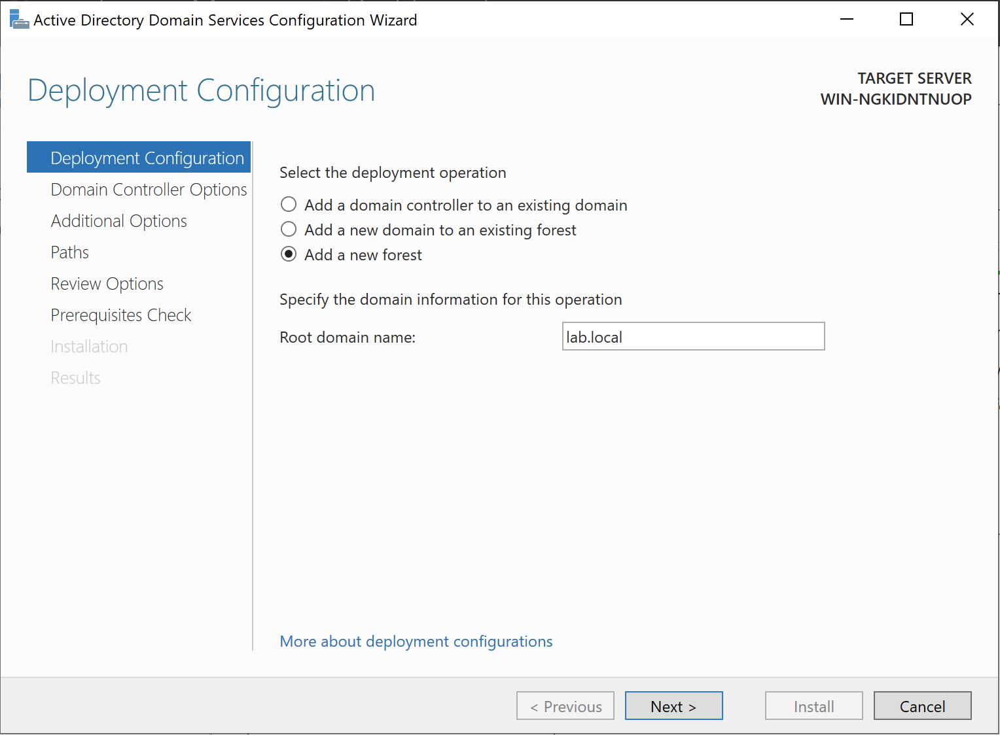
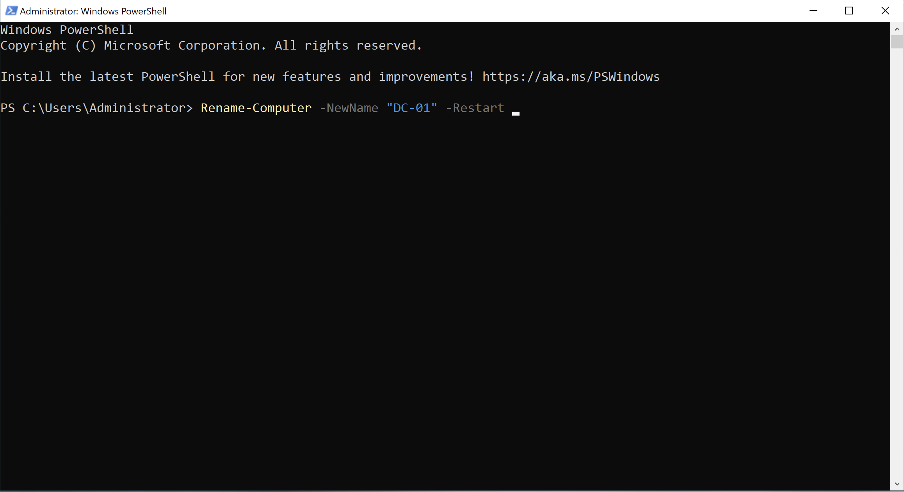
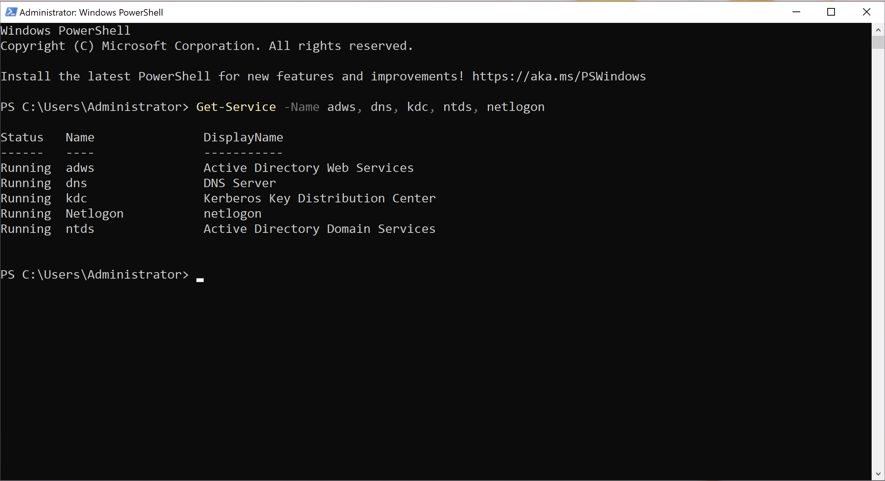
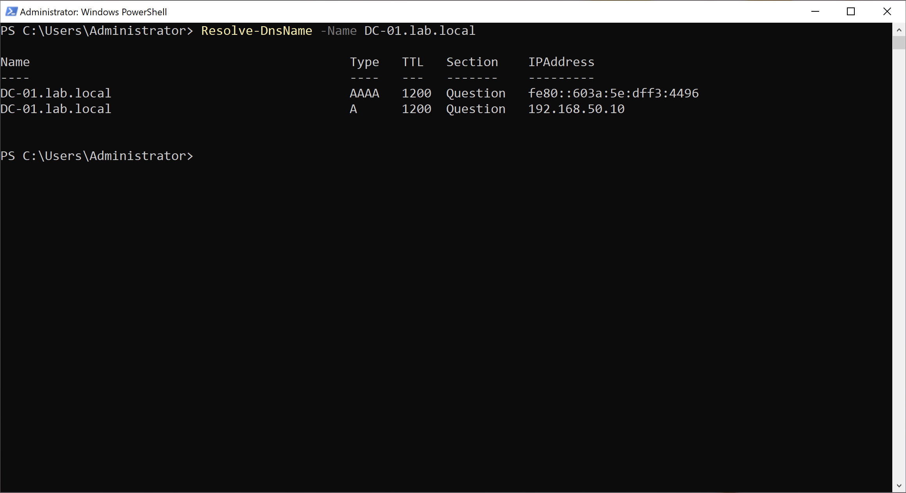

# Module 1: Core Infrastructure and Domain Controller Setup

On WMware Fusion, install two VMs - Windows Server 2022 and Windows 10 Pro - in order to emulate a mini enterprise environment.

## Overview

**1. On Windows Server, configure static TCP/IPv4 properties**
- Open the `Run` dialog (`Win Key + R`) → enter `ncpa.cpl` and hit `Enter`
- Right-click the active network interface and select `Properties`
- Select `Internet Protocol Version 4 (TCP/IPv4)` and assign:
  - `IP Address`: `192.168.50.10`
  - `Subnet Mask`: `255.255.255.0`
  - `Preferred DNS Server`: `127.0.0.1` (pointing to localhost for initial AD DNS setup) 

View Screenshot

 

  

---

**2. Add the Active Directory Domain Services server role**
- On Server Manager: `Manage` → `Add Roles and Features`
- Select `Role-based or feature-based installation` → click `Next` 
- Select server from the server pool (`DC-01`) or just click `Next`
- Check the box `Active Directory Domain Services` → click `Add Features`
- Click `Next` through the remaining screens (Features, AD DS note) without making extra changes
- On the `Confirmation` tab, click `Install`

View Screenshot

 

  
  

___

**3. Promote the server to a domain controller**
- Click the blue link at the top of the wizard window that says `Promote this server to a domain controller`
- Select `Add a new forest`
- In the `Root domain name` field, enter `lab.local`
- Ensure `Domain Name System (DNS) server` and `Global Catalog (GC)` are checked
- Type and confirm a secure password for `Directory Services Restore Mode (DSRM)`
- Keep following the Wizard without changing the default options → click `Install` and reboot

View Screenshot

 

  

___

**4. If not done on install, rename server to** `DC-01` to follow good naming conventions (and replace the standard ugly name)
- Using PowerShell, run `Rename-Computer -NewName "DC-01" -Restart`
- The machine will reboot to apply the changes

View Screenshot

 

  

___

**5. Check if core services were running correctly after rebooting**
- On PowerShell, run `Get-Service -Name adws, dns, kdc, ntds, netlogon`
  - ADWS: Web services interface enabling PowerShell and modern remote AD management
  - DNS: Name resolution engine used to locate Domain Controllers and manage SRV records
  - KDC: Kerberos authentication service issuing security tickets for logins
  - Netlogon: Service handling user authentication, secure channels and domain trusts
  - NTDS (`ntds.dit`): The core database file storing all directory objects and password hashes

View Screenshot

 

  

___

**6. Test DNS resolution on newly configured server**
- On PowerShell, run `Resolve-DnsName -Name DC-01.lab.local`:
  - Asks DNS to convert the hostname into an IP address (IPv4 and IPv6)
  - Displays DNS lookup information like record types and TTL (Time-To-Live)
  - Checks if the machine can successfully reach Active Directory's DNS
- `DC-01.lab.local` is a Fully Qualified Domain Name (FQDN)
  - `DC-01` is the hostname (the unique name of the virtual machine or server on the network)
  - `lab.local` is the Active Directory domain name (that the machine or server belongs to)

View Screenshot

 

  

