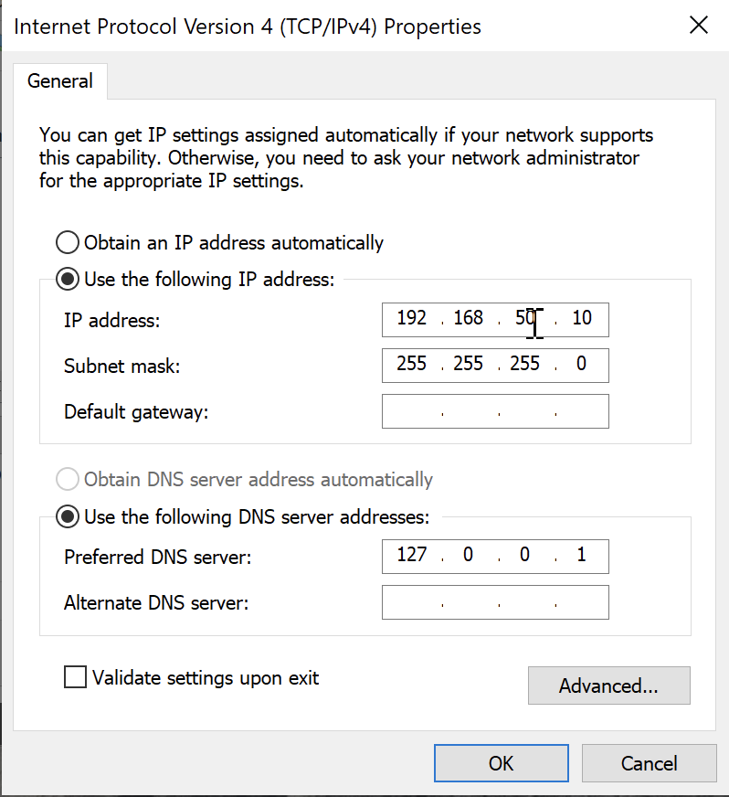
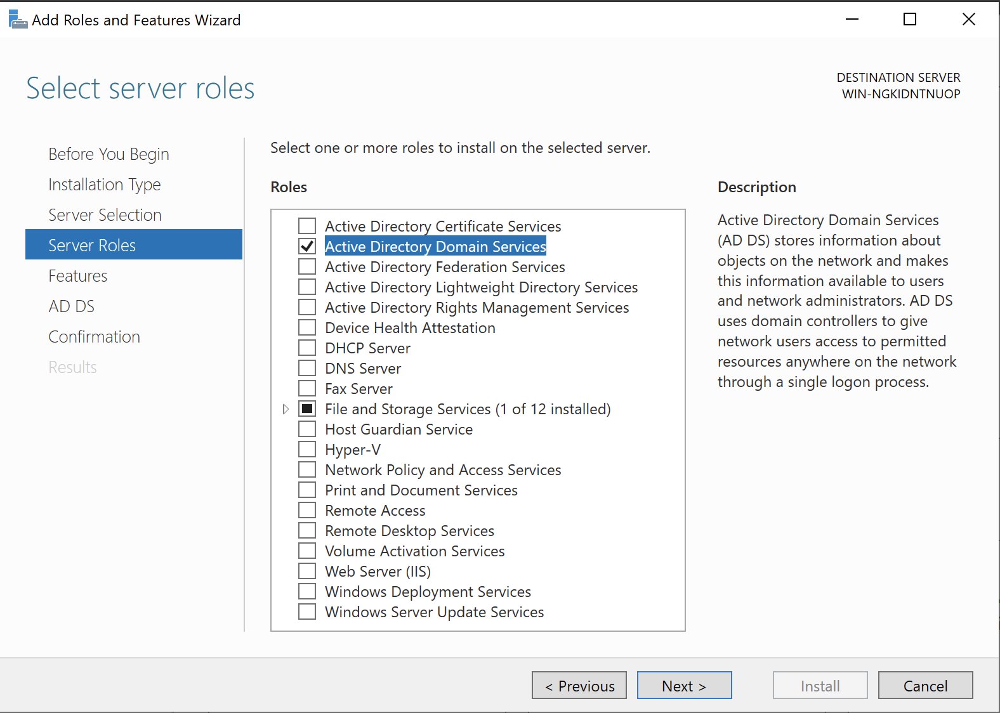
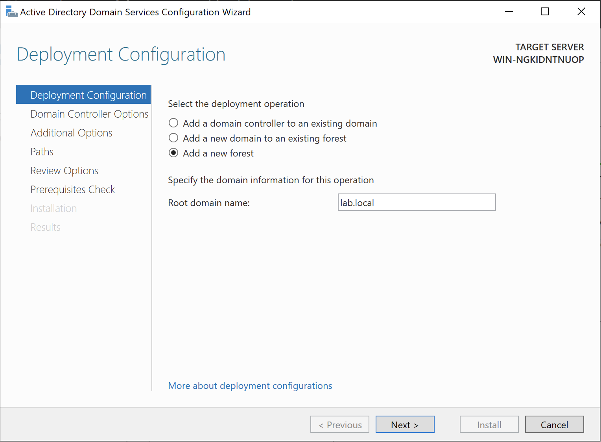
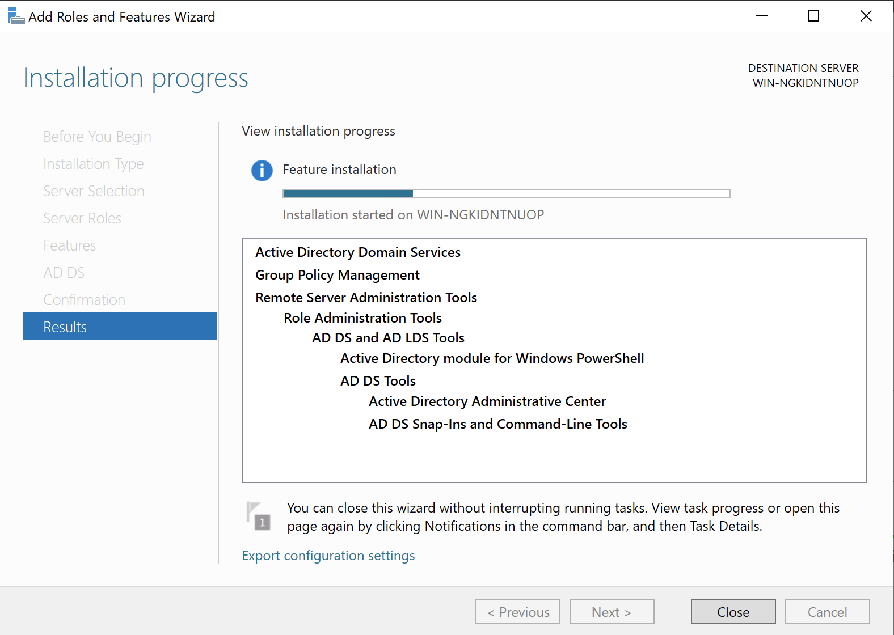
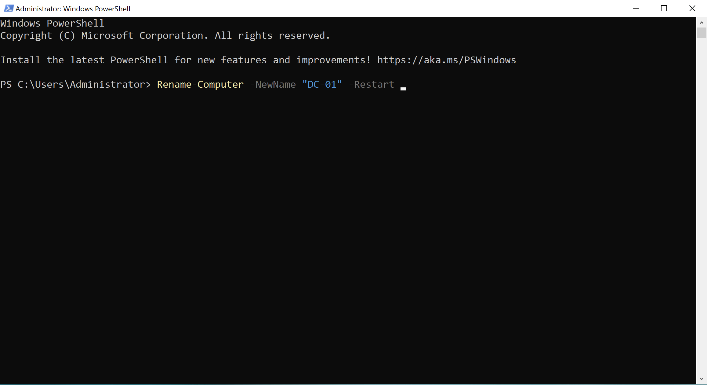
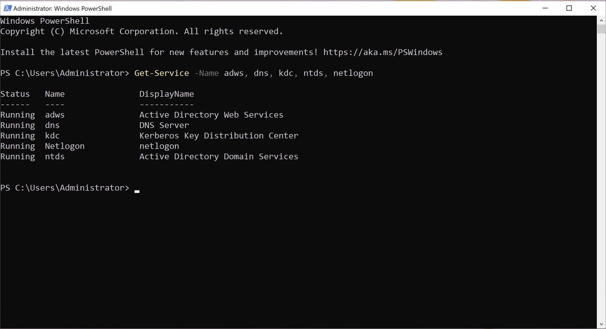
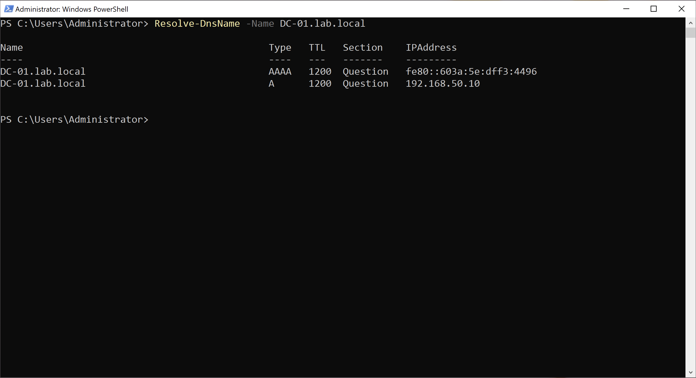

# Module 1: Core Infrastructure & Domain Controller Setup

On WMware Fusion, I installed two VMs - Windows Server 2022 and Windows 10 Pro - in order to emulate a mini enterprise environment.

## Overview

**1. Set the** `TCP/IPv4` **properties on Windows Server :** Assigned a static IP address (`192.168.50.10`), a Subnet mask of `255.255.255.0` and a DNS address pointing to the machine itself (`127.0.0.1`), so that the server VM could resolve incoming DNS requests from the client VM 

View Screenshot

 

  

---

**2. Added the Active Directory Domain Services** server role via Server Manager

View Screenshot

 

  

___

**3. Promoted the server to create a new forest named** `lab.local`

View Screenshot

 

  

___

**4. Installed Active Directory Domain Services (AD DS)** which installs DNS functionality by default

View Screenshot

 

  

___

**5. Renamed server to** `DC-01` **to follow good naming conventions** (and replace the standard ugly name)

View Screenshot

 

  

___

**6. Checked if core services were running correctly after rebooting**

View Screenshot

 

  

___

**7. Tested DNS resolution on newly configured server**

View Screenshot

 

  

