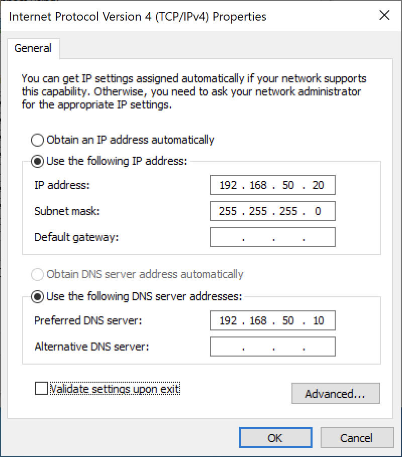
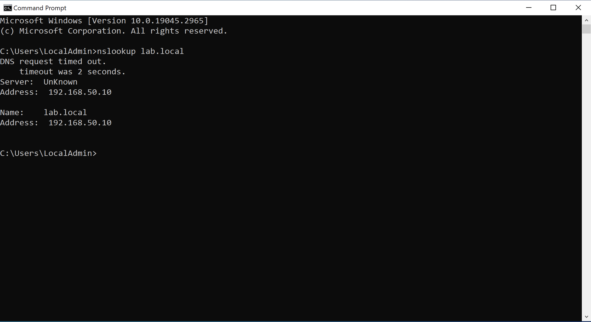
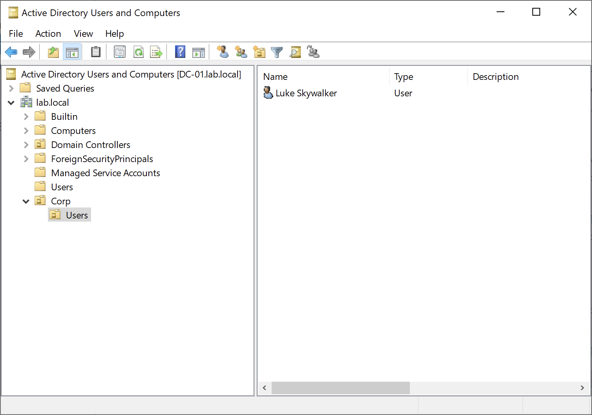
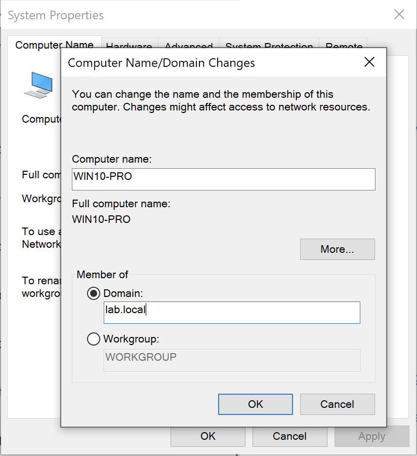
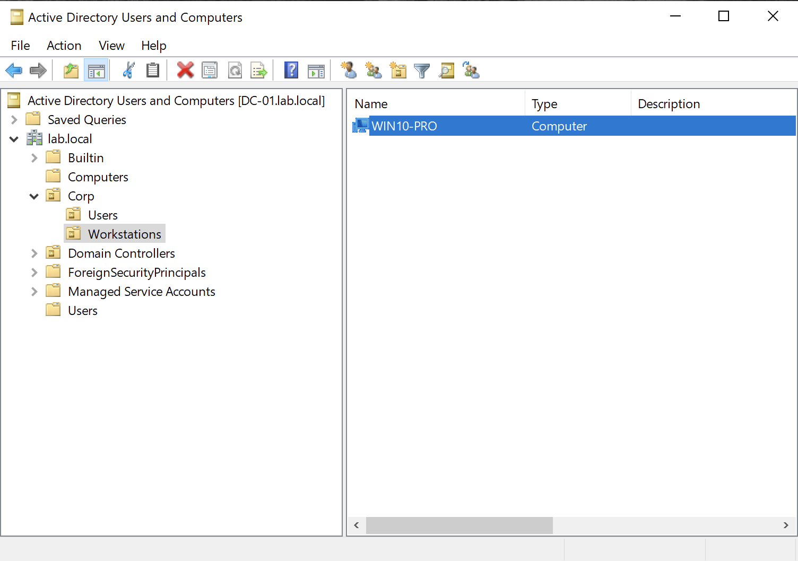
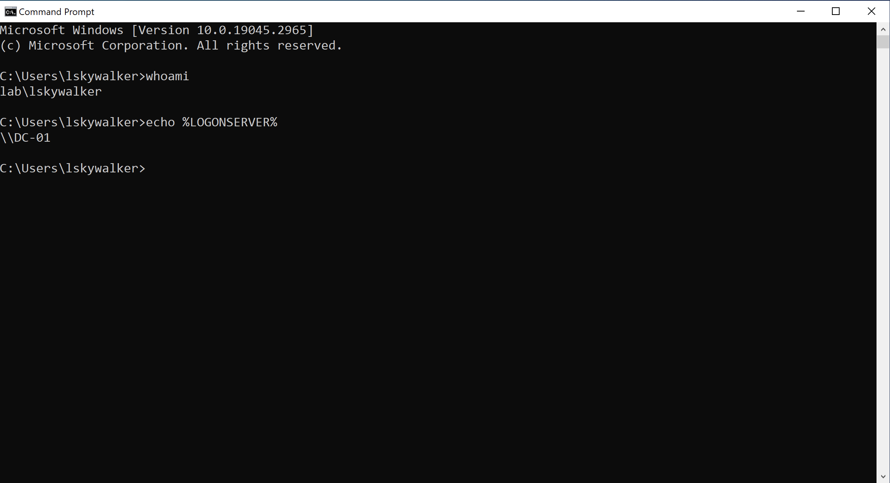
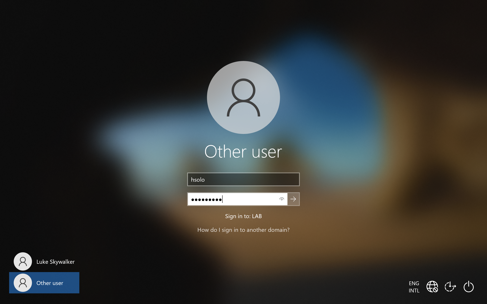

# Module 2: User Creation and Joining
Created users in custom OUs and joined the Windows 10 Pro VM to the `lab.local` domain.

## Overview

**1. Set the TCP/IPv4 properties on Windows 10 Pro client VM :** Assigned a static IP address (`192.168.50.20`), a Subnet mask of `255.255.255.0` and a DNS address pointing to the `DC-01` DNS resolver (`192.168.50.10`)

View Screenshot

 

  

___

**2. Verified domain DNS resolution using 'nslookup lab.local'** confirming it resolved to `192.168.50.10`

View Screenshot

 

  

___

**3. Created user within OU hierarchy in ADUC** : 'Corp -> Users -> Luke Skywalker'

View Screenshot

 

  

___

**4. Renamed client machine to** `WIN10-PRO` **and joined it to the** 'lab.local' **domain** 

View Screenshot

 

  

___

**5. Moved the automatically generated** `WIN10-PRO` **computer object** from the default 'Computers' container into 'Corp -> Workstations'

View Screenshot

 

  

___

**6. Verify logon with 'lskywalker'** via CLI

View Screenshot

 

  

___

**7. Created another domain user Han Solo ('hsolo') inside** 'Corp -> Users'. What would Luke Skywalker be without his companion?

View Screenshot

 

  

