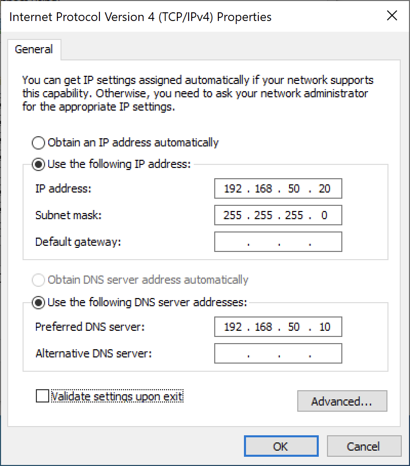
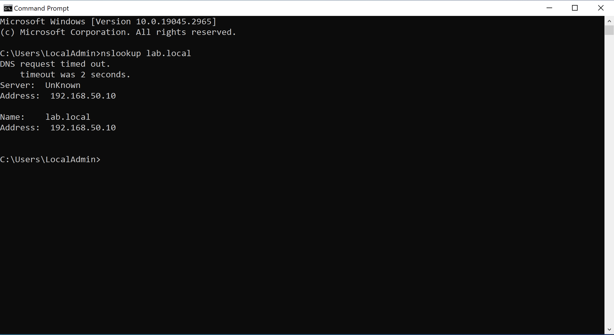
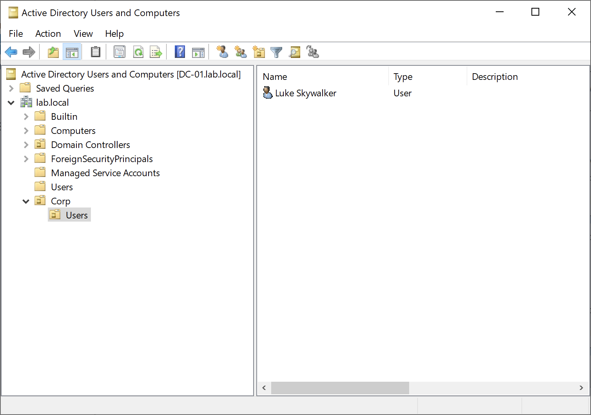
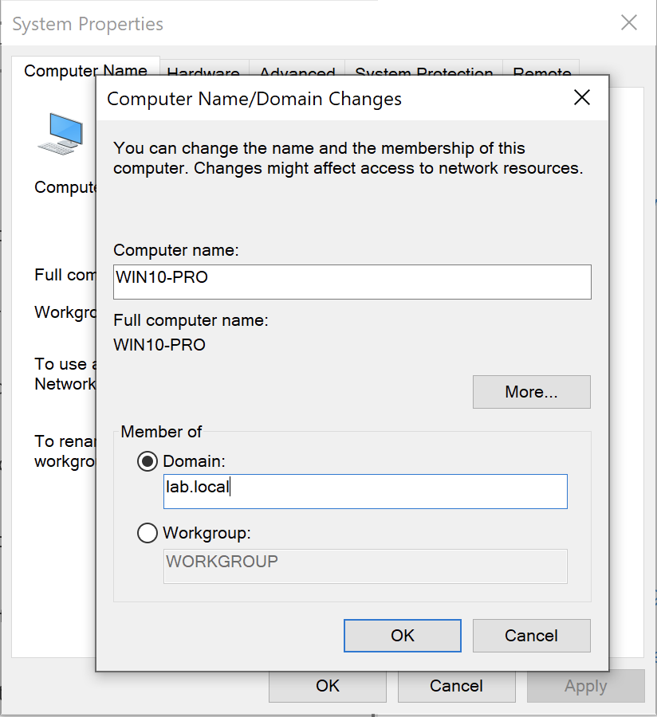
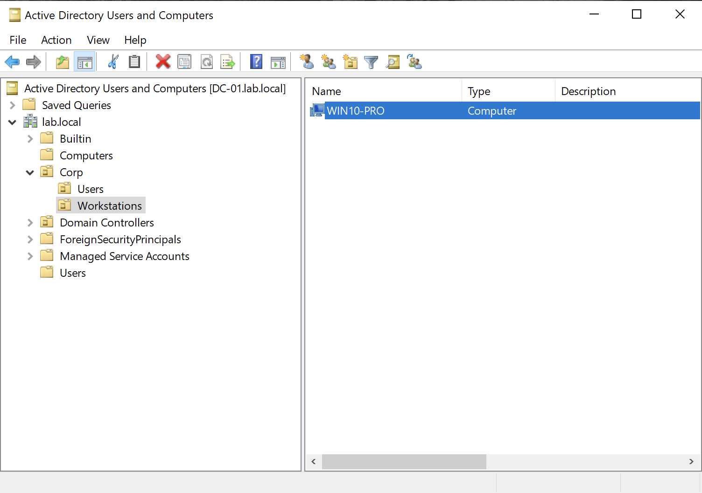
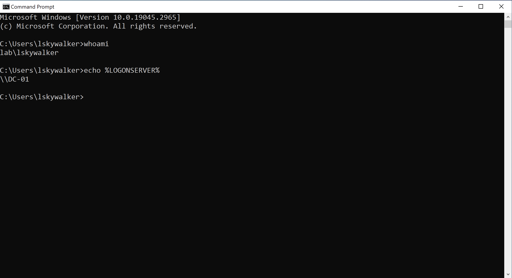

# Module 2: User Creation and Joining
Create users in custom OUs and join the Windows 10 Pro VM to the `lab.local` domain by maually configuring its IPv4 settings.

## Overview

**1. Set the** `TCP/IPv4` **properties on Windows 10 Pro client VM:** 
- `Win + R` to open the `Run` dialog → type in `ncpa.cpl` and Enter
- Right click on network adapter → select `Properties`
- In the list of items, find and double-click `Internet Protocol Version 4 (TCP/IPv4)`
- Select `Use the following IP address` and enter the following properties:
  - IP address: `192.168.50.20`
  - Subnet mask: `255.255.255.0`
  - Default gateway: leave it unset
  - Preferred DNS: `192.168.50.10` (Windows Server's IP)

View Screenshot

 

  

___

**2. Verify domain DNS resolution:** 
- On the Command Prompt, run `nslookup lab.local` to confirm it resolves to `192.168.50.10`

View Screenshot

 

  

___

**3. Create OU hierarchy in ADUC:** 
- Right click on `lab.local` → `New` → `Organizational Unit` → name it `Corp`
- Do the same on `Corp` and create these OUs:
  - `Users`
  - `Groups`
  - `Workstations`
- Right click on `Users` → `New` → `User`:
  - First name: `Luke`
  - Last name: `Skywalker`
  - User logon name: `lskywalker`
- In the next dialog:
  - Enter password
  - Uncheck `Users must change password at next logon`
  - Check `Password never expires`
- Go ahead and finish the setup
- Do the same for the user `Han Solo` (`hsolo`)

View Screenshot

 

  

___

**4. Rename the client machine and join it to the domain:** 
- On the client machine: `Win Key + R` → `sysdm.cpl`
- Under the `Computer Name` tab, click `Change`
- Set the name to `WIN10-PRO`
- In the `Member of` tab, type in `lab.local` and click `OK`
- *Verification*: When prompted, enter the Domain Administrator credentials (`LAB\Administrator` and password)
- Restart the system when prompted to apply the changes

View Screenshot

 

  

___

**5. Move the automatically generated computer object to the custom OU** 
- On `DC-01`, click and drag the new `WIN10-PRO` computer object from the default `Computers` container into `Corp` → `Workstations`
> This is standard enterprise practice to keep things tidy and predictable and to correctly apply Group Policies

View Screenshot

 

  

___

**6. Log on to** `WIN10-PRO`**with a domain account**:
- On the Lock screen, click on `Other User`
- *IMPORTANT*: type `LAB\lskywalker` to make sure to log on to the `LAB` domain and *not* as a local user
- On the Command Prompt, run `whoami` to verify the logon was successful
- Run `echo %LOGONSERVER%`; it should return `\\DC-01` confirming the client is now joined to the Domain Controller

View Screenshot

 

  

