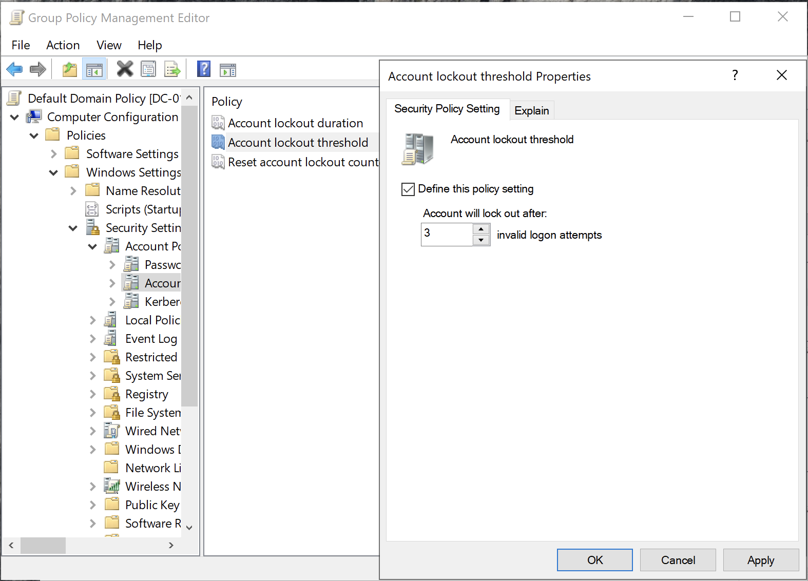
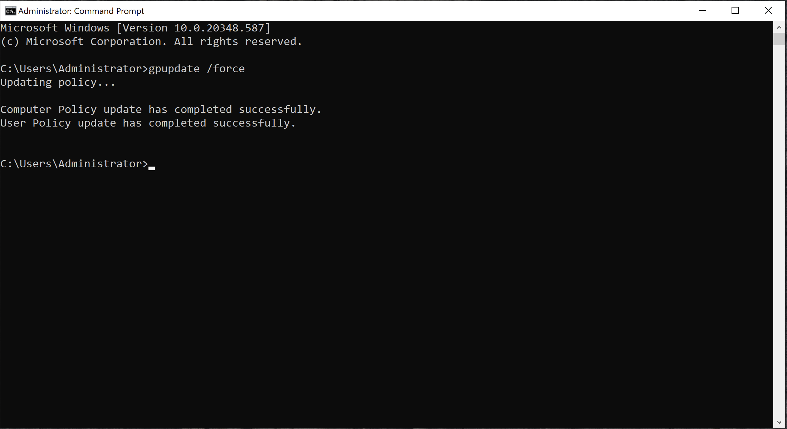
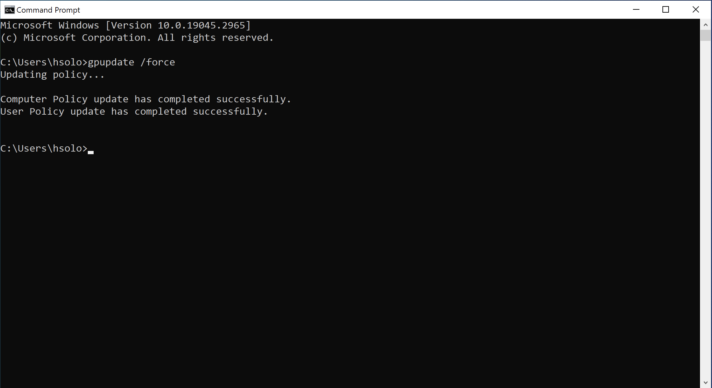
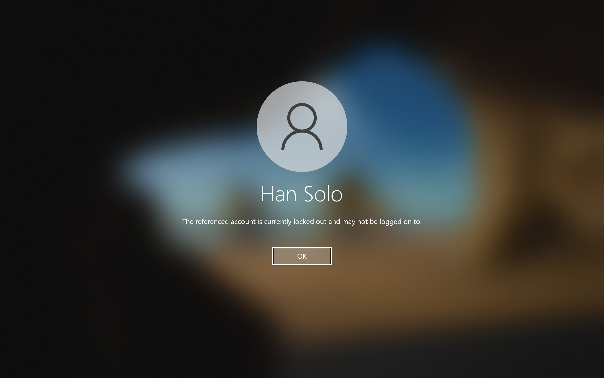
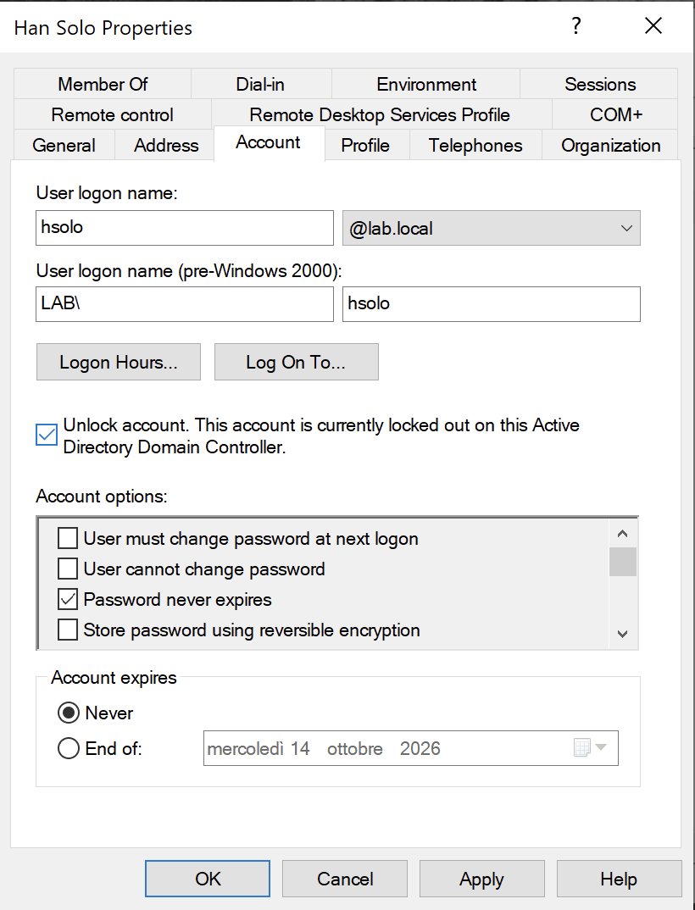
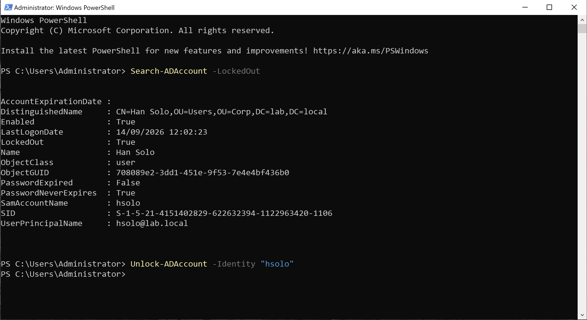

# Module 3: User Lockout Management
Implement a standard security policy to lock the user out if they attempt to enter a password too many times. 

## Overview

**1. In the Group Policy Management Editor**: Set an account **lockout threshold** of 3 attempts, after which the user is locked out and can only be unlocked by the admin

View Screenshot

 

  

___

**2. On the CLI, make sure to update the server machine so that the new policy can take effect...**

View Screenshot

 

  

___

**3. ...as well as on the client machine**

View Screenshot

 

  

___

**4. Enter wrong password enough times to trigger the lockout for the user** `hsolo`

View Screenshot

 

  

___

**5. Unlock the user** `hsolo` **from the ADUC dashboard**

View Screenshot

 

  

___

**6. The account can be searched and unlocked via the CLI as well**

View Screenshot

 

  

