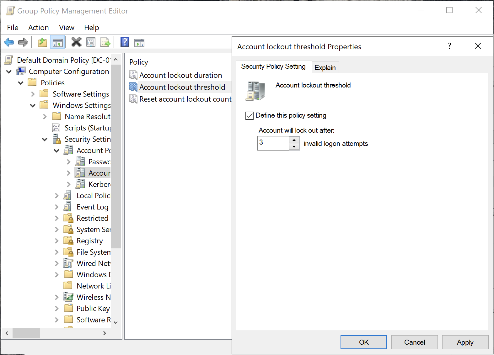
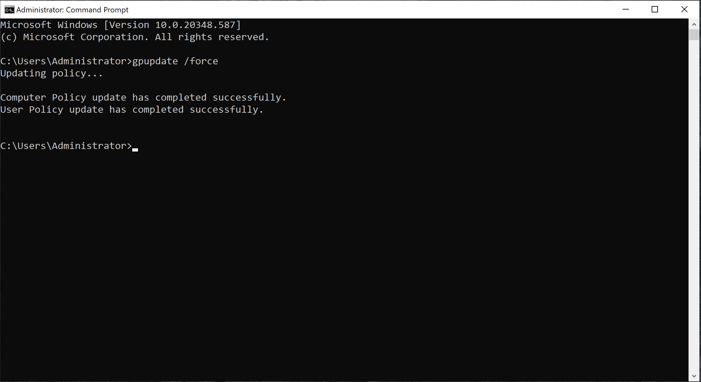
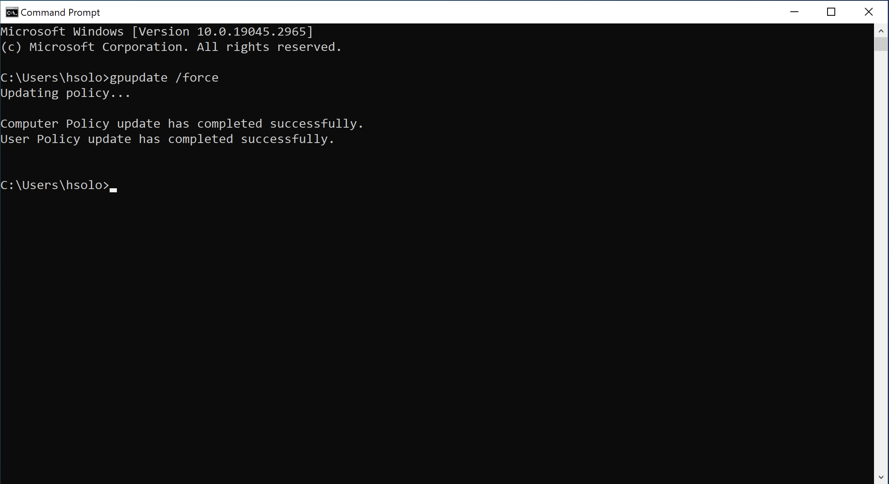
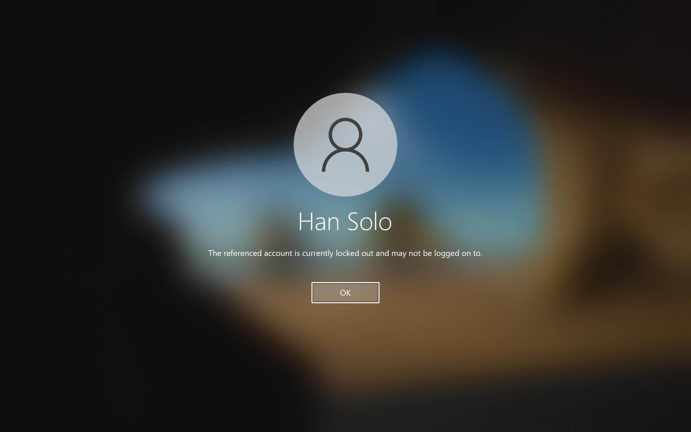
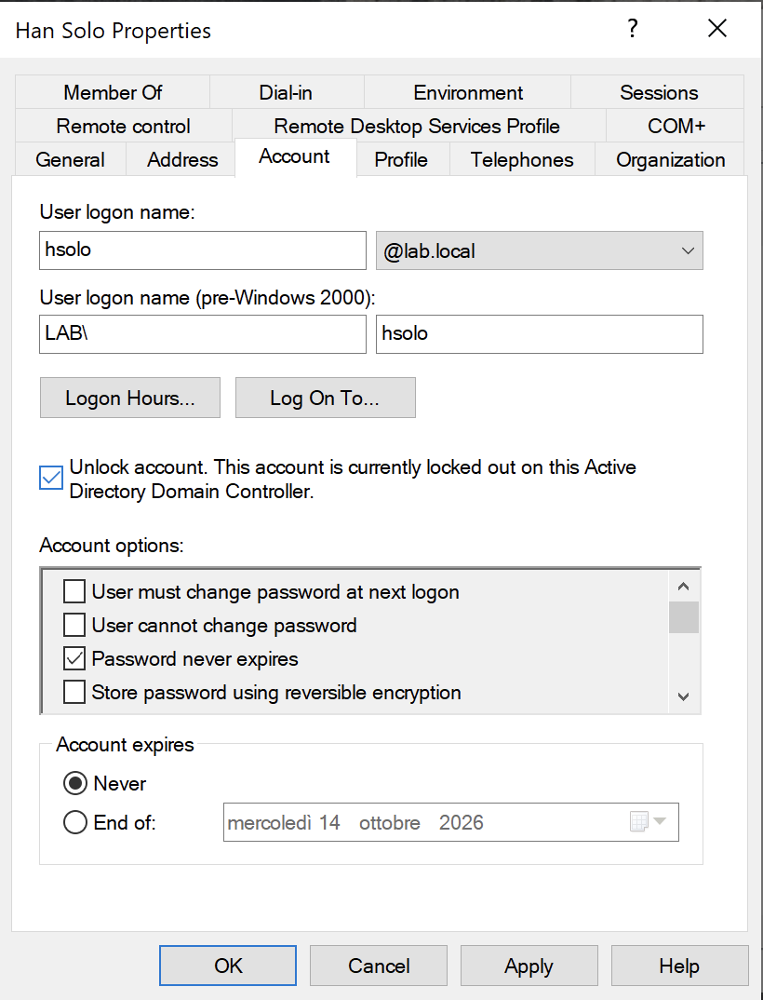
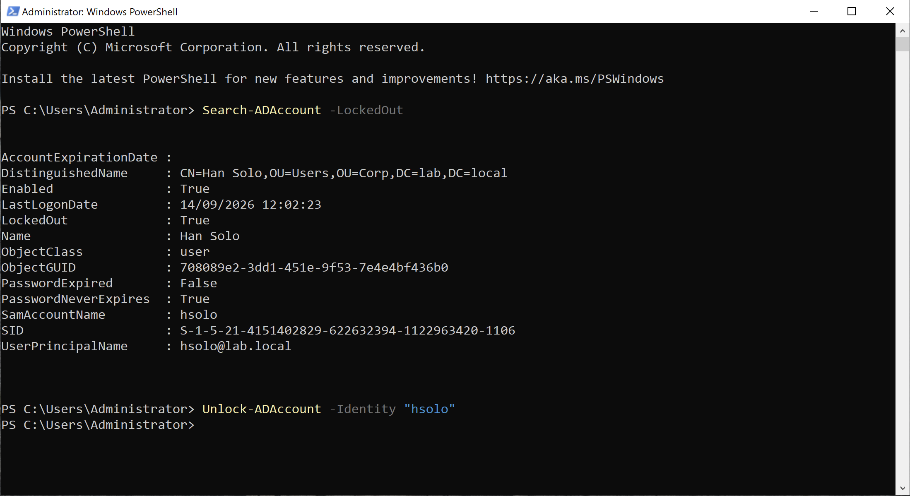

# Module 3: User Lockout Management
Implement a standard security policy to lock the user out if they attempt to enter a password too many times. 

## Overview

**1. On Group Policy Management**: 
- Navigate to `Forest: lab.local` → `Domains` → `lab.local` 
- Right click on `Default Domain Policy` → `Edit...` to open the **Group Management Policy Editor**
- Navigate to `Computer Configuration` → `Policies` → `Windows Settings` → `Security Settings` → `Account Policies` → `Account Lockout Policy`
- Check `Define policy setting` and enter `3` in the underlying field. This sets an account **lockout threshold** of 3 attempts, after which the user is locked out and can only be unlocked by the admin

View Screenshot

  

  

___

**2. Update policy on the server machine**
- On `DC-01`, run `gpupdate /force` so that the new policy can take effect

View Screenshot

 

  

___

**2. Update policy on the client machine**
- On `WIN10-PRO`, run `gpupdate /force` so that the new policy can take effect

View Screenshot

 

  

___

**4. Test the new lockout policy** 
- Enter the wrong password enough times to trigger the lockout for the user (e.g.`hsolo`)

View Screenshot

 

  

___

**5. Unlock the user as an admin**
- On Active Directory Users and Computers, double click on a user (e.g. `Han Solo`) to open `Properties`
- Click on the `Account`, check `Unlock account` and apply
* The account can be unlocked via the CLI as well:
  - Run `Search-ADAccount -LockedOut` to get a list of locked accounts with details
  - Run `Unlock-ADAccount -Identity "hsolo"`

View Screenshots

 

  

  

