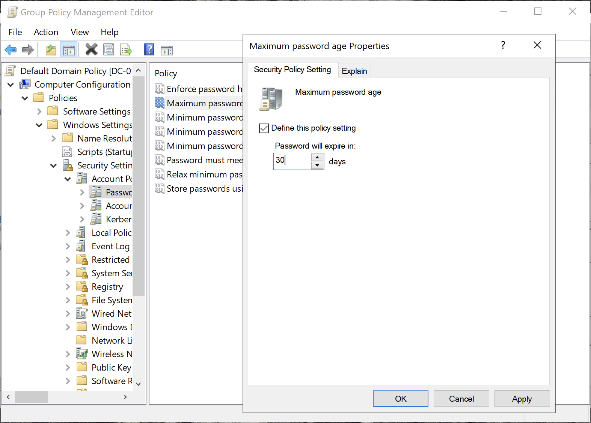
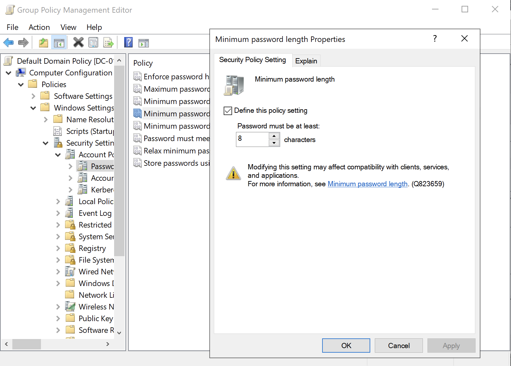
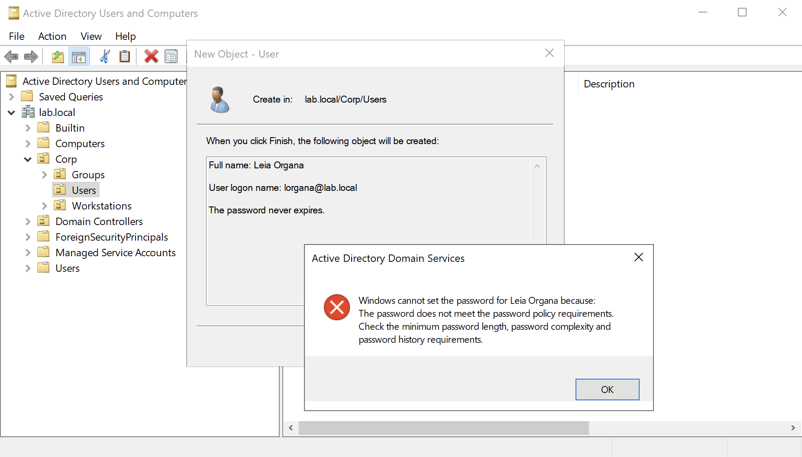
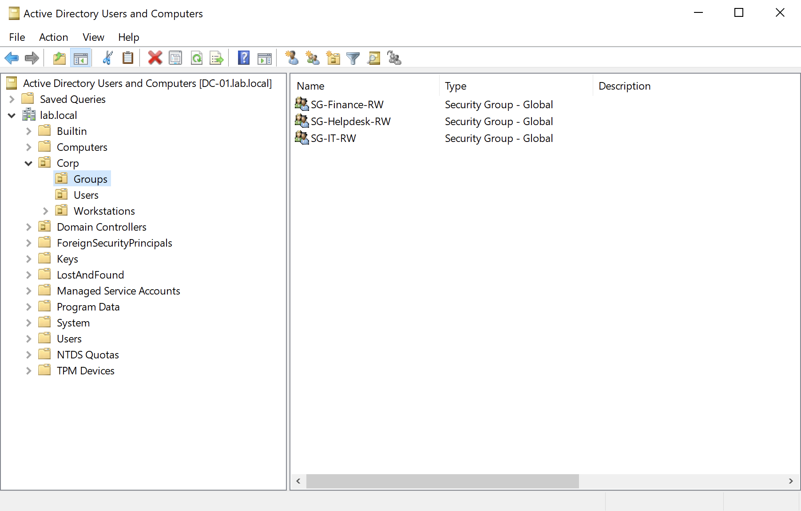
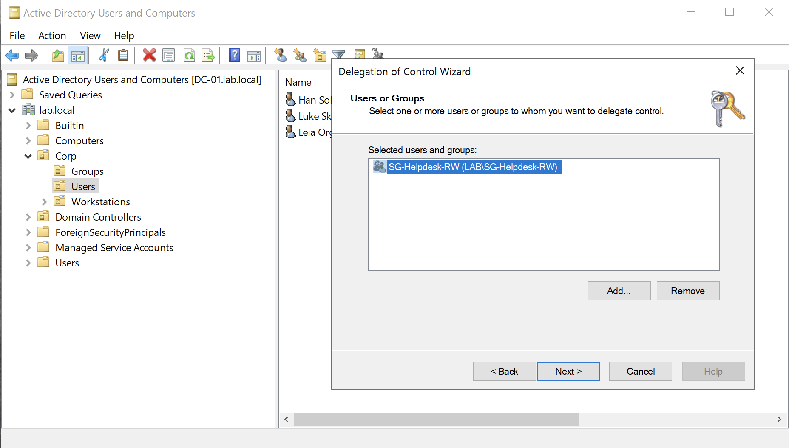
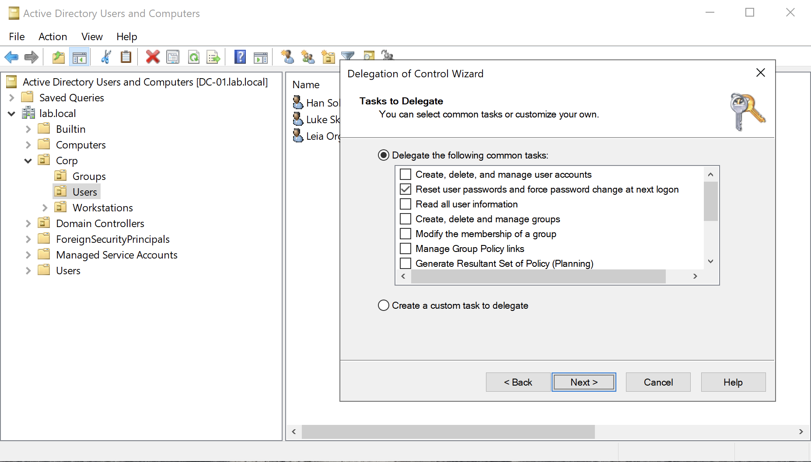
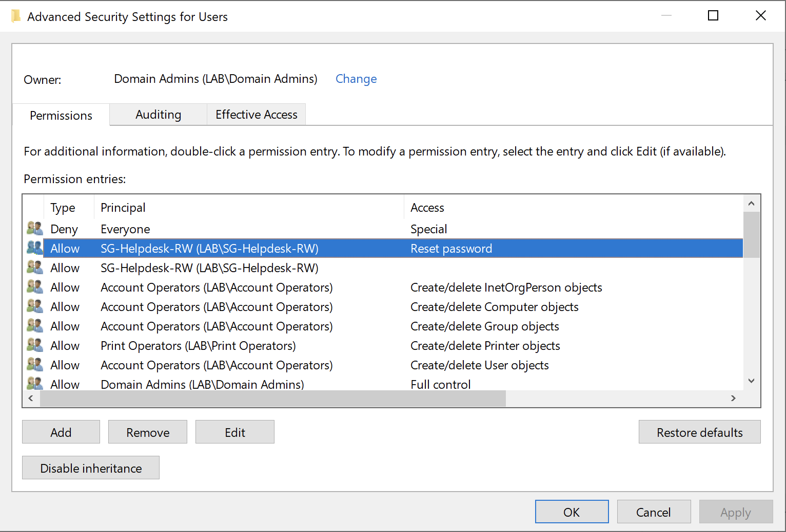

# Module 4: Password Policy and Delegation
Delegated password reset capabilities to the Helpdesk group. Domain password policies were configured via the **Default Domain Policy** at the domain root. Implementing advanced, granular rules remains outside the scope of this lab.

## Overview

**1. Configured Domain Password Policy**: Navigated to `Default Domain Policy` → `Account Policies` → `Password Policy` in GPMC to set a maximum password age...

View Screenshot

 

  

___

**2. ...and a minimum password length**

View Screenshot

 

  

___

**3. Attempted to assign a non-compliant password** to newly created user `lorgana`

View Screenshot

 

  

___

**4. Created new Security Groups** and assigned members to each:
- `lskywalker` to `SG-Finance-RW`
- `lorgana` to `SG-Helpdesk-RW`
- `hsolo` to `SG-IT-RW`

View Screenshot

 

  

___

**5. Executed the Delegation of Control Wizard** on the `Corp/Users` OU

View Screenshot

 

  

___

**6. Granted** `SG-Helpdesk-RW` **permission to reset user passwords and force changes at next logon**

View Screenshot

 

  

___

**7. Enabled Advanced Features in ADUC to verify explicit** `Reset password` **rights** under `Corp/Users` -> `Properties`-> `Security`

View Screenshot

 

  

