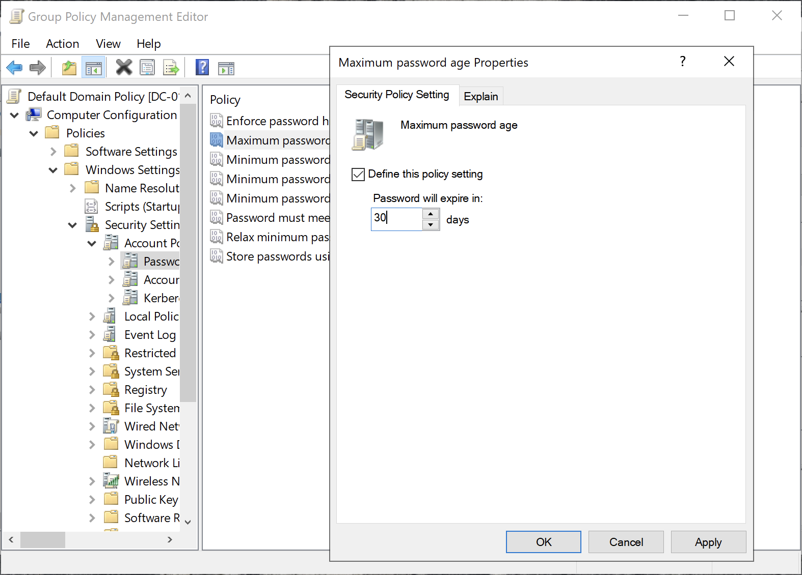
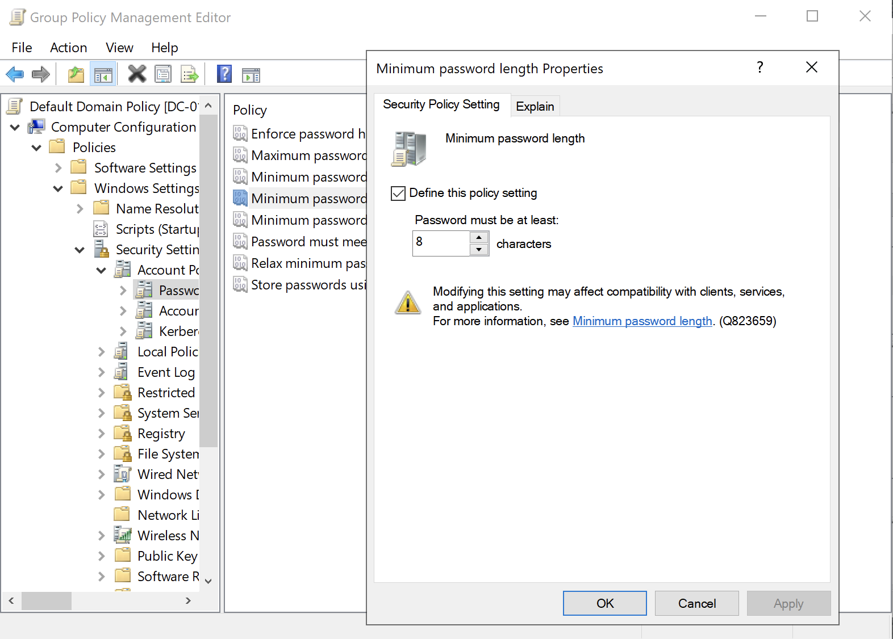
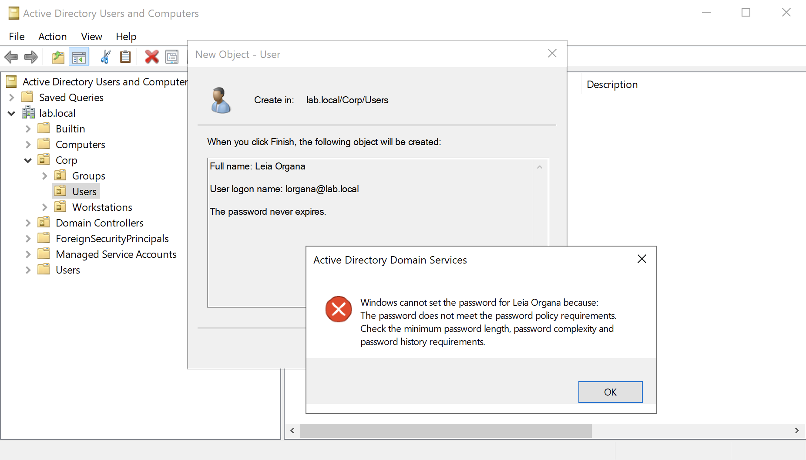
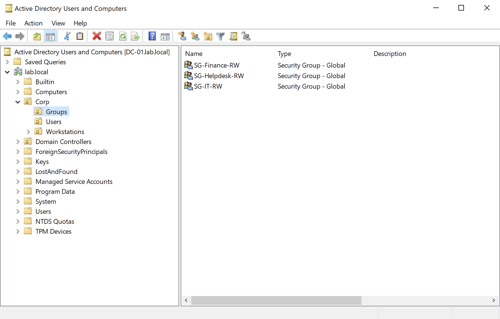
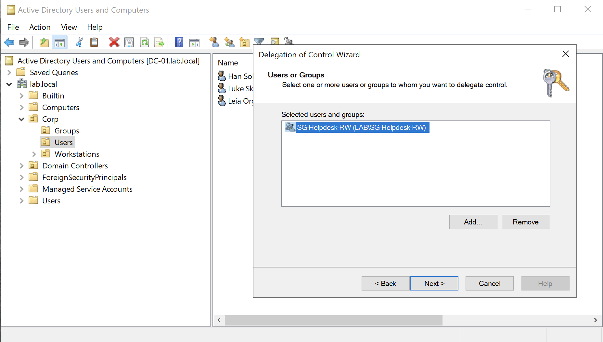
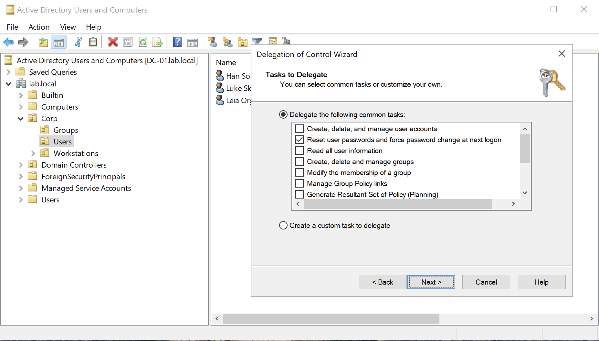
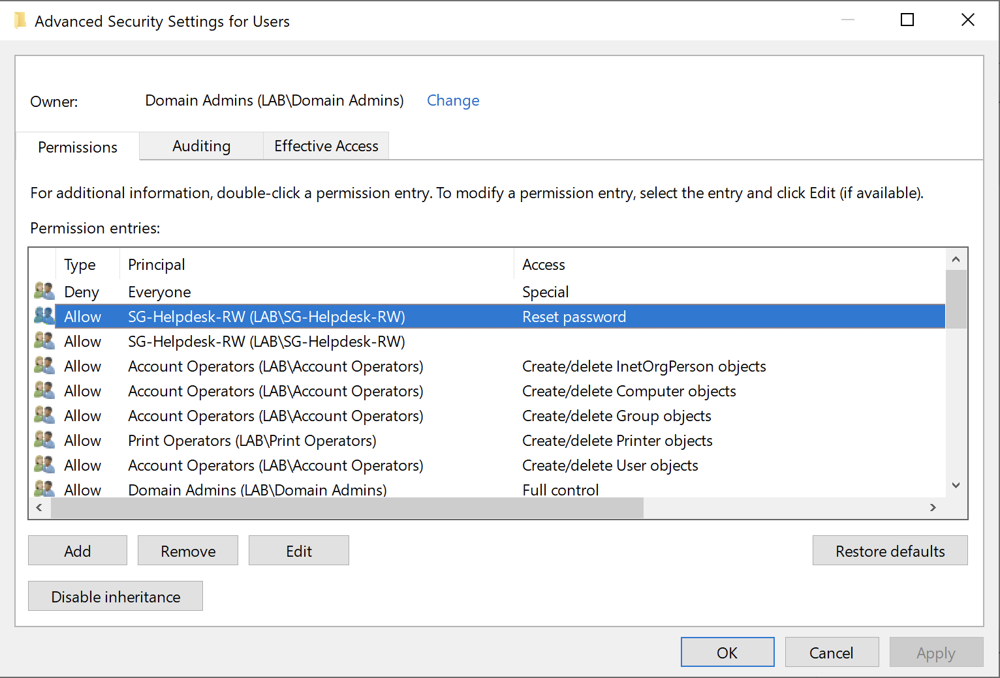

# Module 4: Password Policy and Delegation
Delegate password reset capabilities to the Helpdesk group. Domain password policies are configured via the **Default Domain Policy** at the domain root. Implementing advanced, granular rules remains outside the scope of this lab.

## Overview

**1. Configure Domain Password Policy**: 
- On the Group Policy Management Editor, navigate to `Default Domain Policy` → `Account Policies` → `Password Policy` in GPMC
 - Check `Define this policy setting` and set et a maximum password age (e.g. 30 days)
 - Do the same for the minimum passowrd length (e.g. 8 characters)

View Screenshots

 

  

  

___

**2. Password test on new user**
- Create a new user `Leia Organa` (`lorgana`)
- Attempt to assign a non-compliant password

View Screenshot

 

  

___

**3. Create new Security Groups and assign members**:
- On the `Corp` OU, right click and select `New` → `Group`
- Name it `SG-IT-RW` and leave the default options
- Right click on the group → `Properties` → `Members` tab → `Add`
- Search for `hsolo` and add it to the group
- Do this again as follows: 
  - `SG-Helpdesk-RW` and add `lorgana` as a member
  - `SG-Finance-RW` and add `lskywalker` as a member

View Screenshot

 

  

___

**4. Create a Delegation Group to manage passwords** 
- Right click `Users` → `Delegate Control...` 
- On the Delegation of Control Wizard, add `SG-Helpdesk-RW` 
- Check `Reset user passwords and force changes at next logon`
> Now, whoever belongs to the Helpdesk group is allowed to manage user passowrds

View Screenshots

 

  

  

___

**5. Verify explicit** `Reset password` **rights**:
- On ADUC, click `View` → `Advanced Features`
- Navigate to `Corp/Users` → `Properties` → `Security` tab → `Advanced`

View Screenshot

 

  

