# Module 5: Shares and Permissions
Implement a secure, scalable enterprise file sharing infrastructure using the AGDLP (Account → Global Group → Domain Local Group → Permission) access management model. This module demonstrates configuring network file shares, standardizing SMB share permissions, and implementing explicit NTFS Access Control Lists (ACLs).

## Overview

**1. Create physical folder** in `C:\Shares\CompanySharedData`

View Screenshot

 

  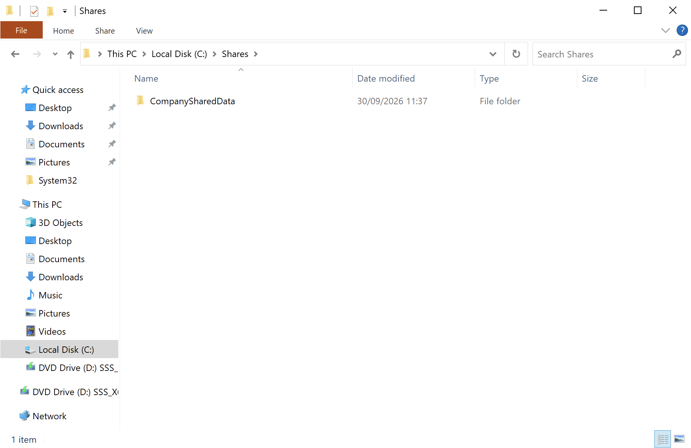

___

**2. Create share via Computer Management** (`compmgmt.msc`): 
- **Create A Share Folder Wizard**: `System Tools` → `Shared Folders` → right-click `Shares` → `New Share...`
- Select the `C:\Shares\CompanySharedData` path → `Next`
- Name, Description, and Settings: Keep `Share name` as `CompanySharedData` → `Next`
- Select `Customize permissions` -> `Custom...`

View Screenshots

 

  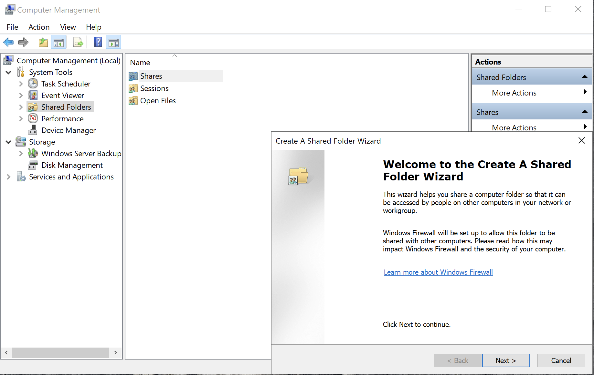

  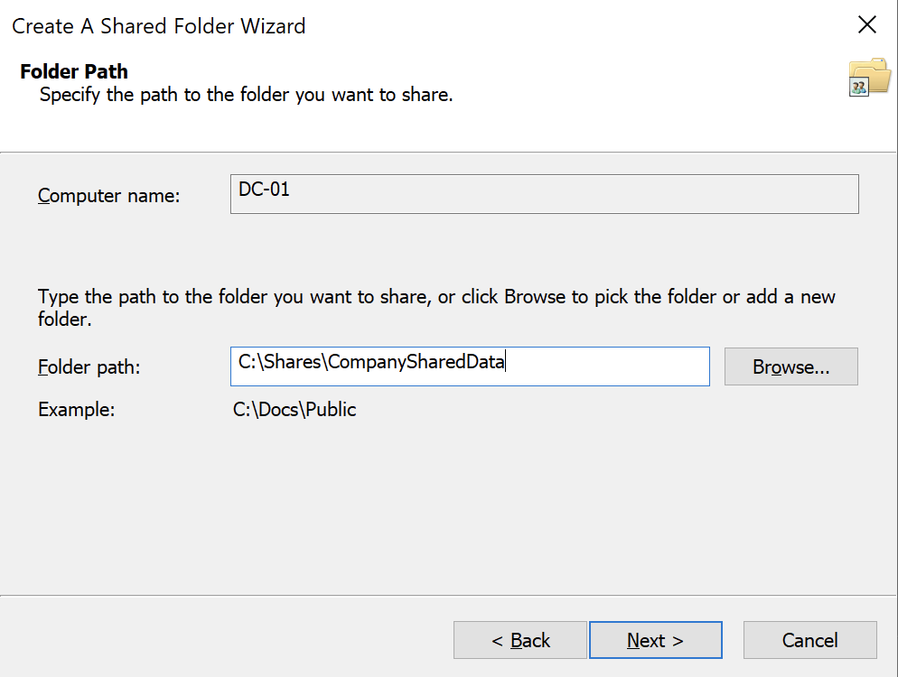

  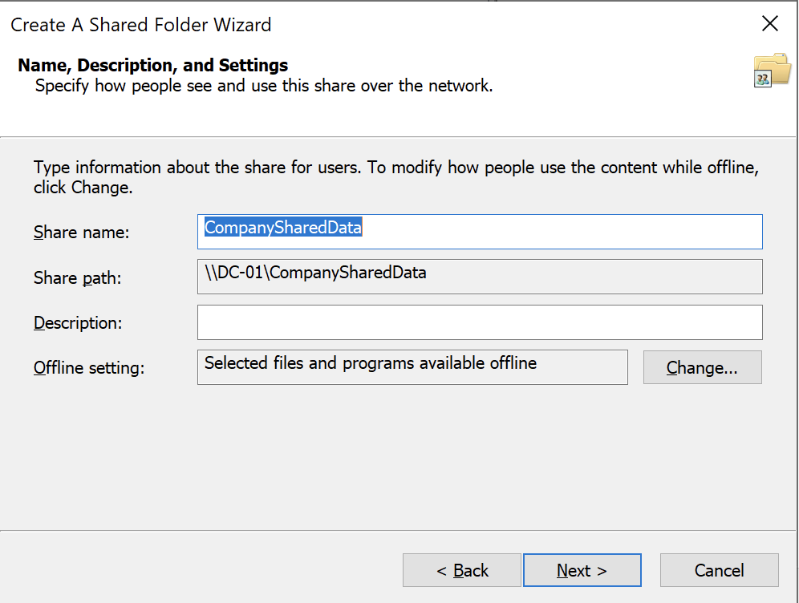

  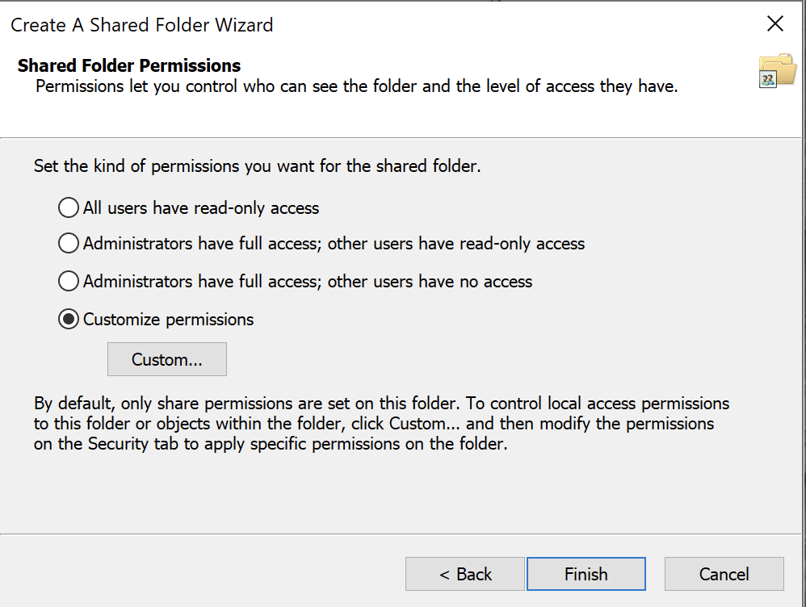

___

**3. Add the** `Authenticated Users` **identity to the list** and allow `Full Control`.
This ensures that the share is only open for users that have received an access token from the Domain Controller (at the SMB level). In a later passage this setting will be fine-tuned to grant access only to a Domain Local Group

View Screenshot

 

  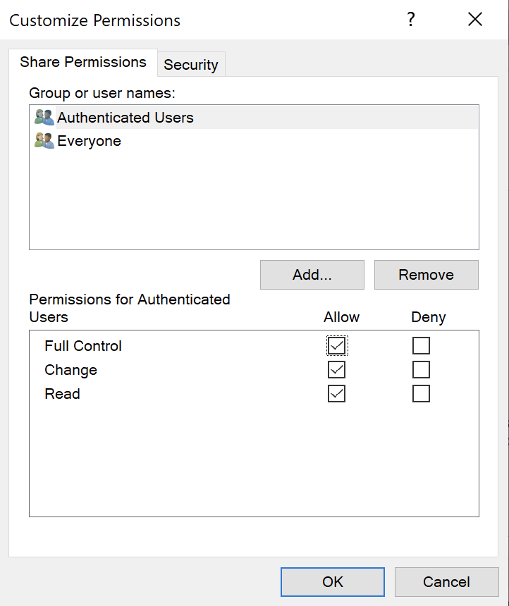

___

**4. In Active Directory Users and Computers**:
- Inside the `Corp\Groups` OU, create a new Domain Local Group (DL) named `DL-CompanySharedData-RW`
- Add the Global Groups as members (`SG-Finance-RW`, `SG-Helpdesk-RW`, `SG-IT-RW`)

View Screenshots

 

  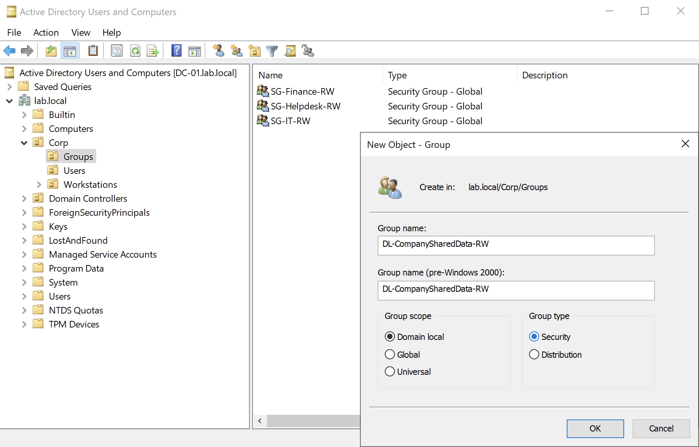

  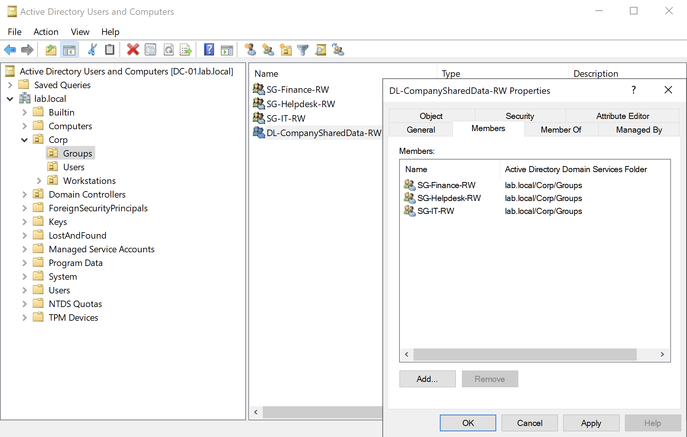

___

**5. Configure explicit NTFS Permissions** (`DC-01`):
- Navigate to `C:\Shares` → right click on `CompanySharedData` → `Properties` → select `Security` tab → `Advanced`
- `Disable inheritance` and select `Convert inherited permissions into explicit permissions on this object` to prevent the `CompanySharedData` folder to inherit permissions from parent folders and to configure explicit NTFS permissions on it

View Screenshot

 

  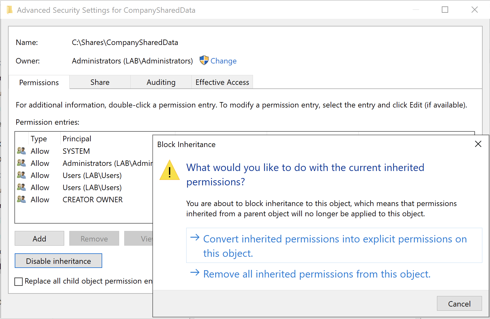

___

**6. In the** `Permission entries` **list, remove default generic NTFS entries** such as `Users` or `Authenticated Users` (leave `SYSTEM` and `Administrators` intact)

View Screenshot

 

  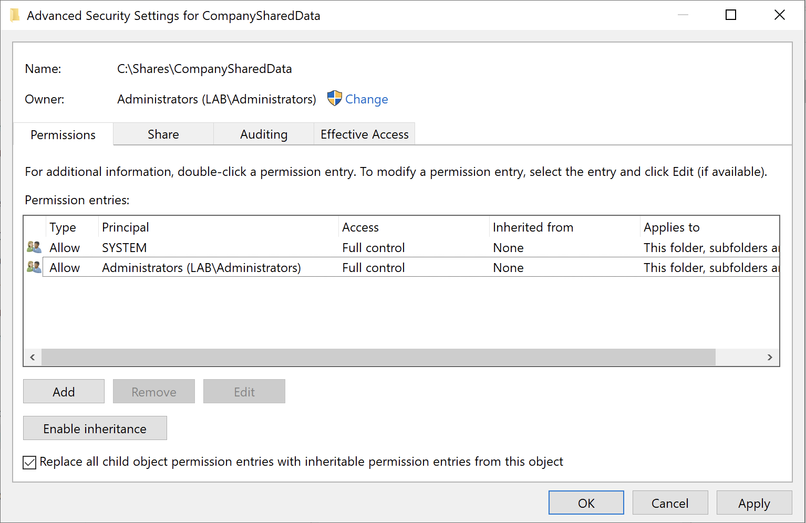

___

**7. Grant permissions to the Domain Local Group**:
- `Add` → `Select a principal` → enter `DL-CompanySharedData-RW`
- Under `Basic permissions`, check `Modify` (this automatically selects `Read & execute`, `List folder contents`, `Read` and `Write`)

View Screenshot

 

  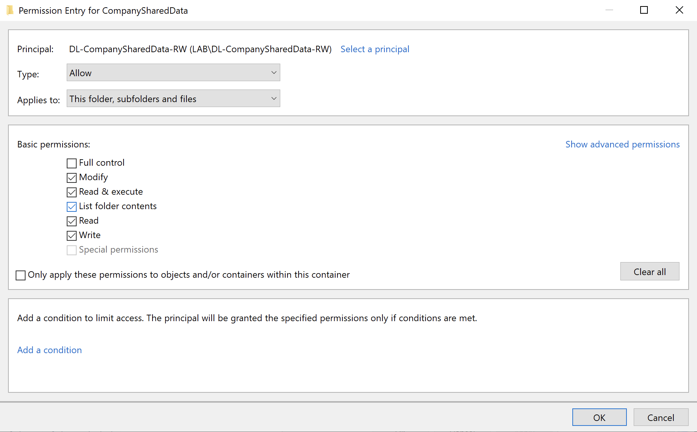

___

**8. Test and validate access from Client** (`WIN10-PRO`):
- Log into `WIN10-PRO` as a user (e.g. `hsolo`)
- `Win + R` → enter `\\DC-01\CompanySharedData` (the UNC path)
- Verify that File Explorer opens the shared folder without any prompt or permission errors
- Create a file inside the shared folder

View Screenshot

 

  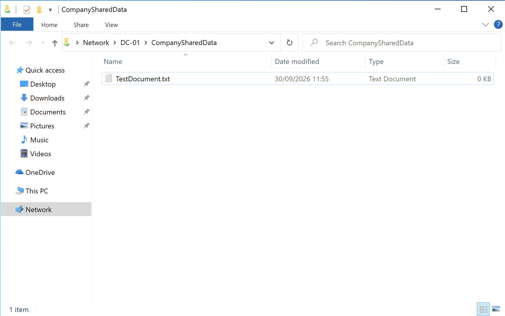

