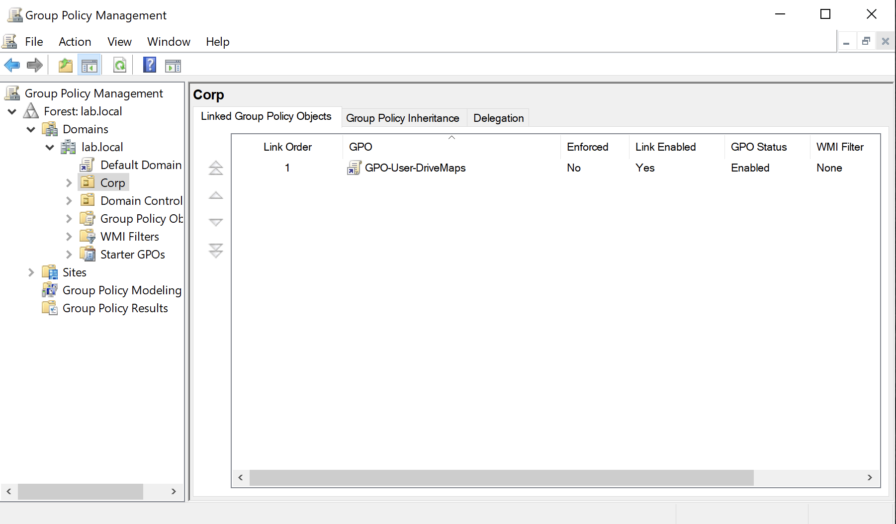
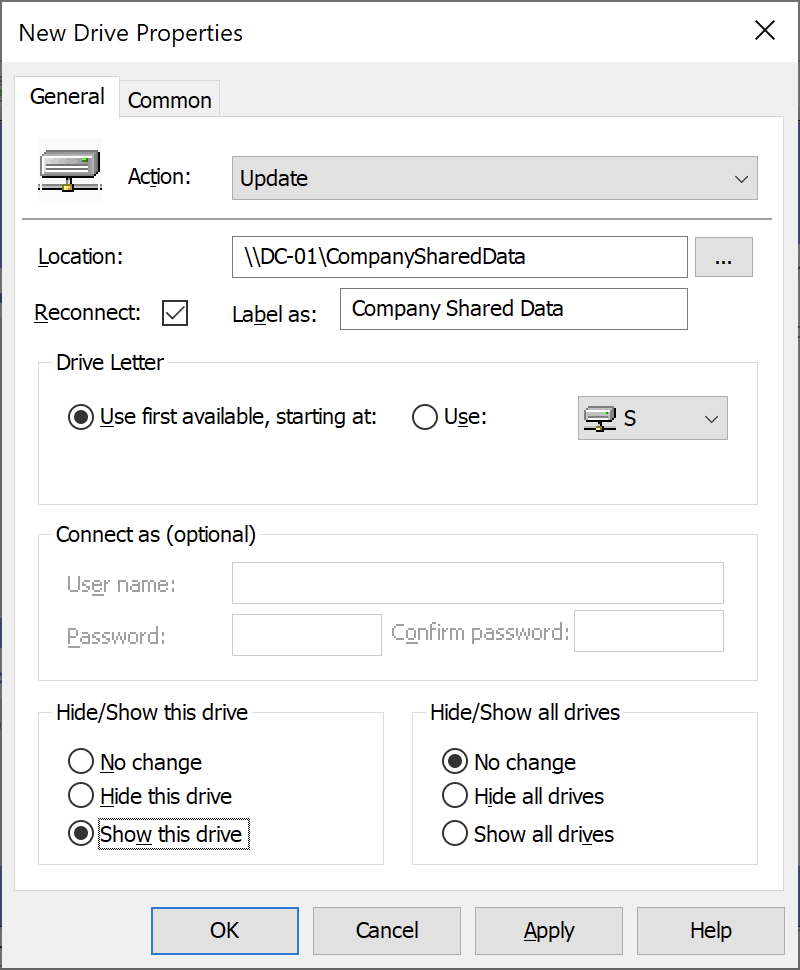
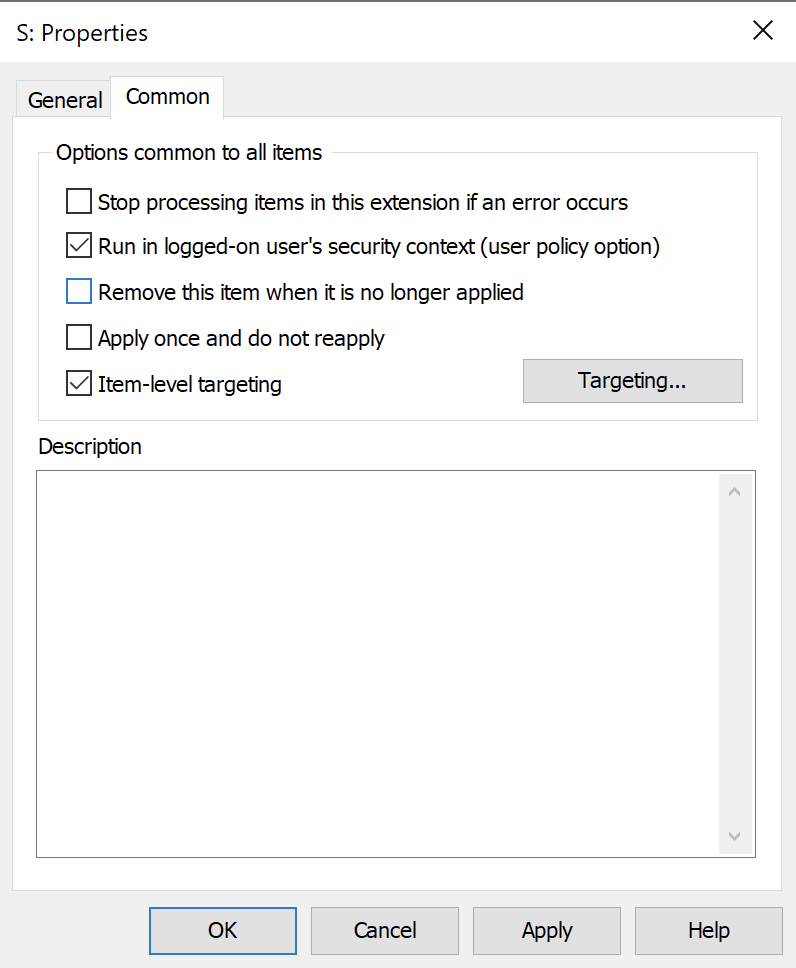
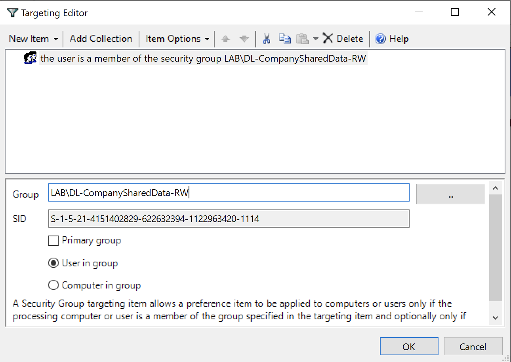
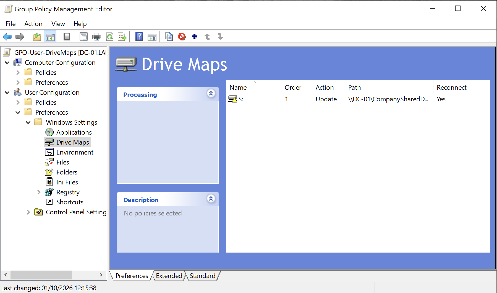
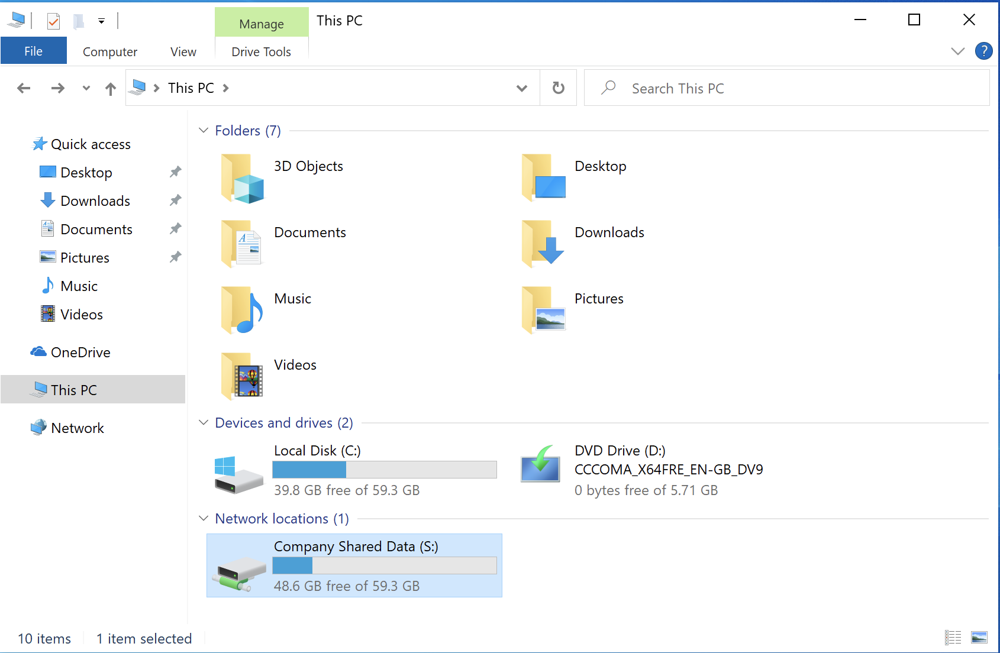

# Module 6: Drive Mapping
Create a Group Policy Object (GPO) on `DC-01` that automatically maps `\\DC-01\CompanySharedData` as the `S:` drive on domain workstations whenever a user in `DL-CompanySharedData-RW` logs on.

## Overview

**1. On the Open Group Policy Management**:
- Right-click on the top-level OU (`Corp`) and select `Create a GPO in this domain, and Link it here...`
- Enter the name `GPO-User-DriveMaps`

View Screenshot

 

  

___

**2. Configure New Mapped Drive Settings**:
- Right click `GPO-User-DriveMaps` and select `Edit...` to open the Group Policy Management Editor
- Navigate to `User Configuration` → `Preferences` → `Windows Settings` → `Drive Maps`
- Right click the blank area inside the `Drive Maps` pane, select `New` → `Mapped Drive`

___

**3. In the** `General` **tab**:
- `Action`: select `Update` - best practice: creates the map if missing, updates it if changed
- `Location`: type the exact UNC path: `\\DC-01\CompanySharedData`
- Check the `Reconnect` box - tells Windows to remember the drive mapping across future logons, even if Group Policy isn't able to contact the Domain Controller
- `Label`: type `Company Shared Data`
- Check `Use first available starting from` and select drive letter `S:`
- Select `Show this drive`

View Screenshot

 

  

___

**4. In the** `Common` **tab**:
- Check `Run in logged-on user's security context (user policy option)` - forces Group Policy to execute that specific preference under the interactive user's credentials rather than the local `NT AUTHORITY\SYSTEM` account
- Check `Item-Level targeting` - ensures that users only get drive mappings for shares they actually have permissions to open
- Click `Targeting...`

View Screenshot

 

  

___

**5. In the** `Targeting Editor` **window**:
- Drop-down menu `New Item` → `Security Group`
- In the `Group` box, click `...`, type in and select `DL-CompanySharedData-RW`
- Check `User in group`

View Screenshot

 

  

___

**5. Verify the new drive in the** `Drive Maps` **window**

View Screenshot

 

  

___

**6. Test and Verify on Client Workstation**
- Log in to `WIN10-PRO` as a domain user who belongs to `DL-CompanySharedData-RW` (e.g., `lorgana`)
- Force a Group Policy update on the CLI (`gpupdate /force`)
- Navigate to `This PC` on the File Explorer

View Screenshot

 

  

