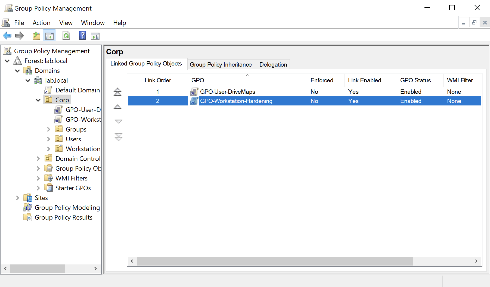
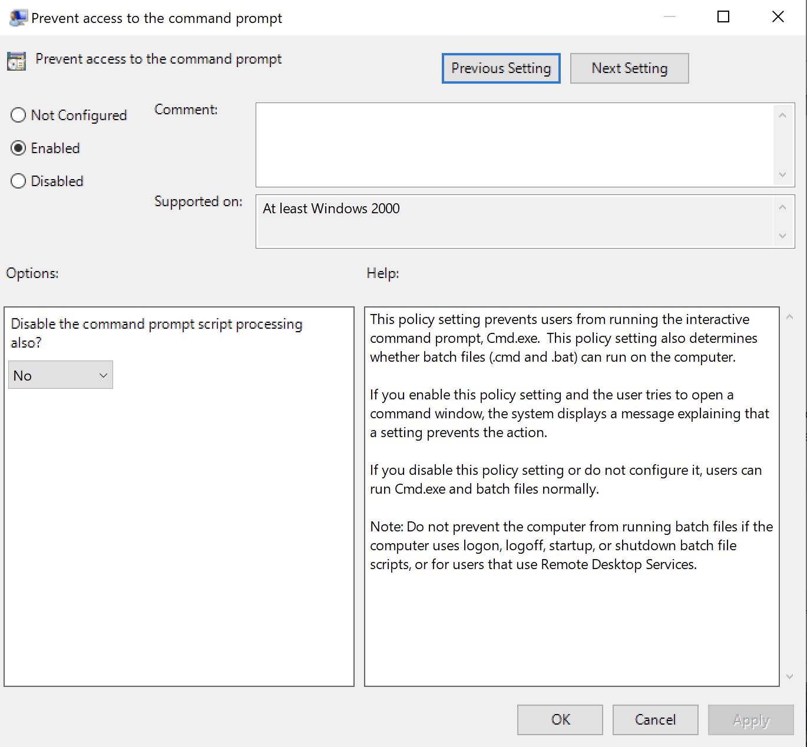
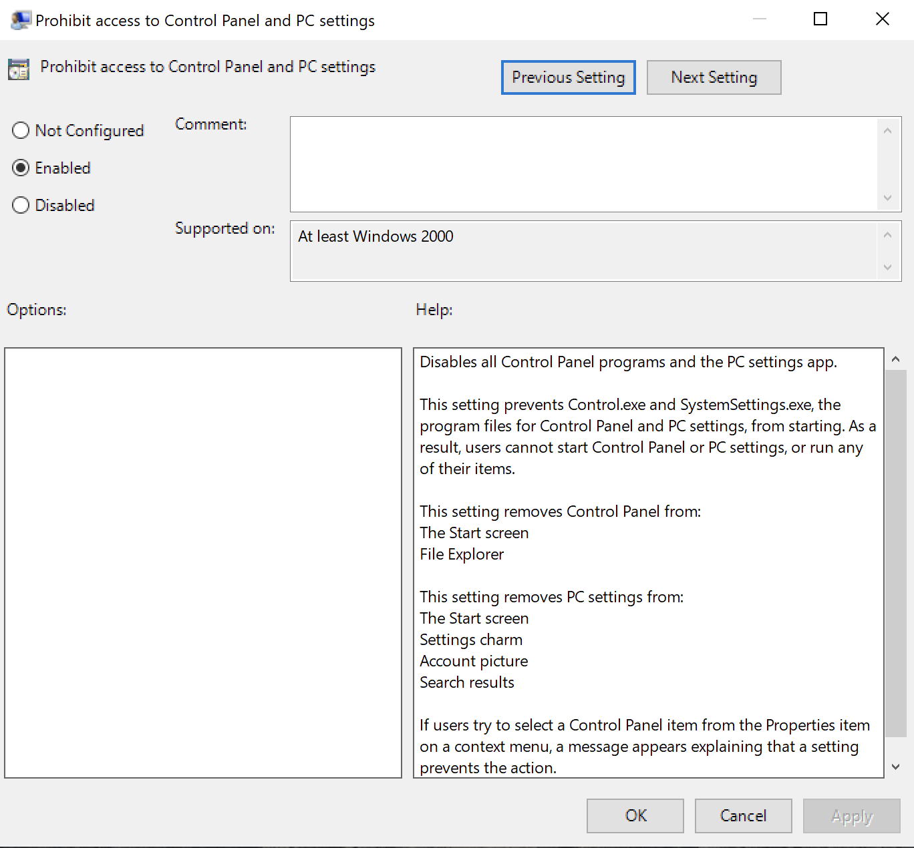
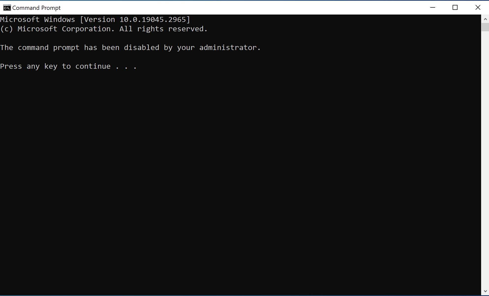
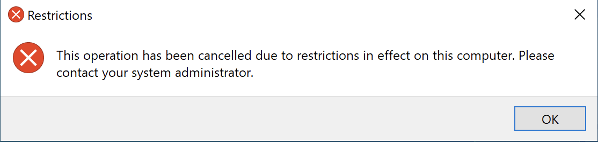

# Module 7: Enterprise Group Policy & Workstation Hardening
Use Group Policy Objects (GPOs) to lock down domain-joined Windows 10 endpoints by restricting access to administrative settings.

## Overview

**1. Create a new GPO within the Group Policy Management Console**:
- Right click on `Corp` → `Create a GPO in this domain, and Link it here...` → name it `GPO-Workstation-Hardening`
- Right click on `GPO-Workstation-Hardening` → `Edit`

View Screenshot

 

  

___

**2. Prevent the authenticated user from accessing the command prompt**:
- Navigate to `User Configuration` → `Policies` → `Administrative Settings` → `System`
- Open `Prevent access to the command prompt` and select `Enable`

View Screenshot

 

  

___

**3. Prevent the authenticated user from accessing the Control Panel and PC Settings**:
- Navigate to `User Configuration` → `Policies` → `Administrative Settings` → `Control Panel`
- Open `Prohibit access to Control Panel and and PC settings` and select `Enable`

View Screenshot

 

  

___

**4. While logged on as a domain user, try opening the command prompt...**

View Screenshot

 

  

___

**5. ...as well as the Control Panel**:

View Screenshot

 

  

___