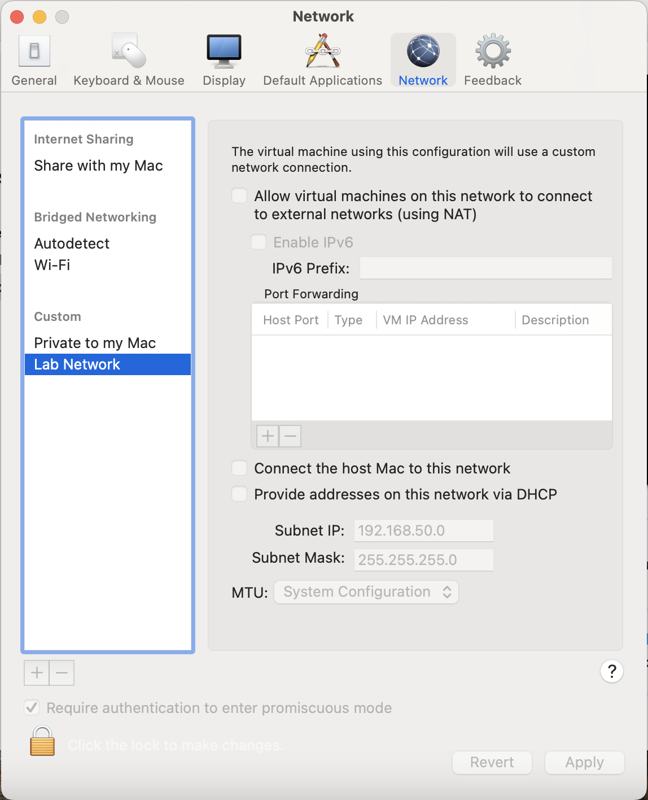
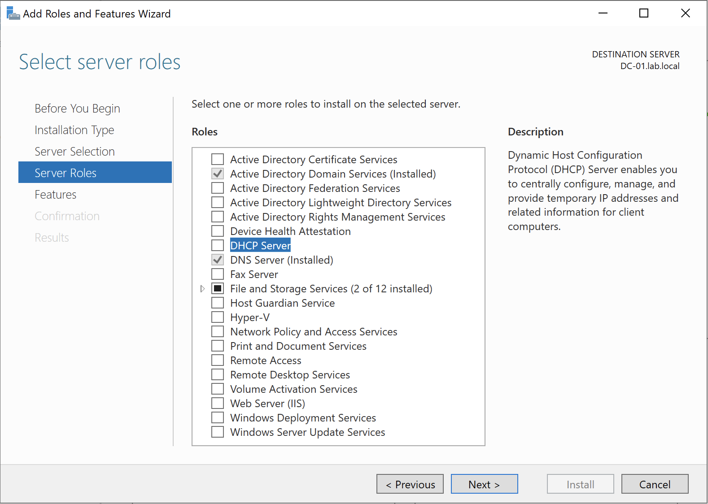
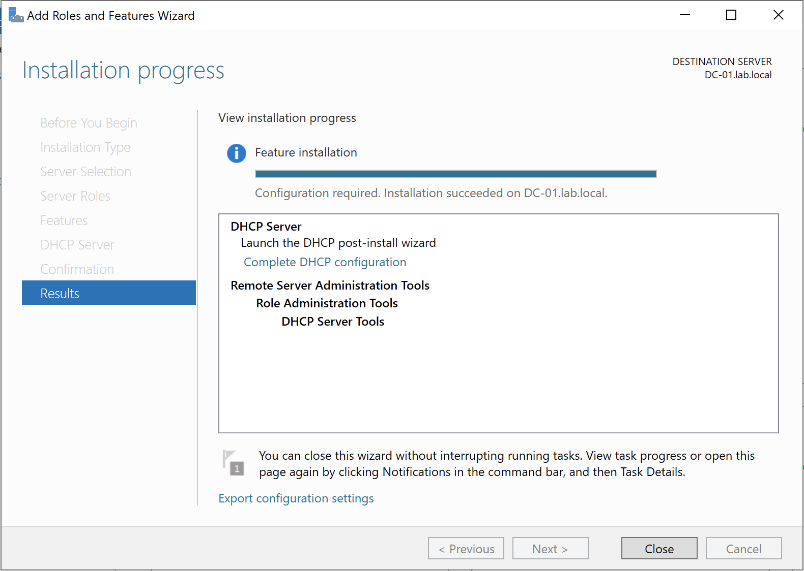
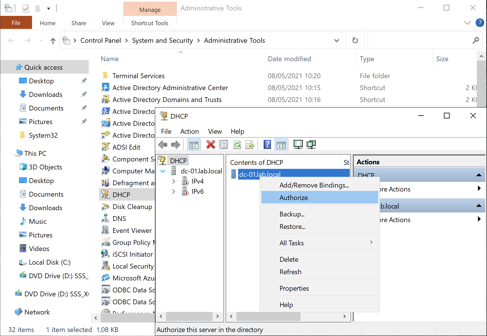
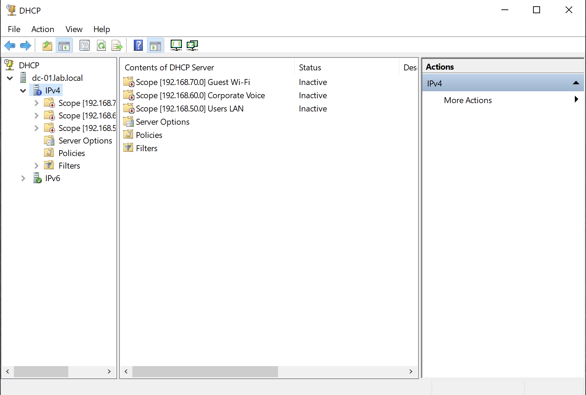
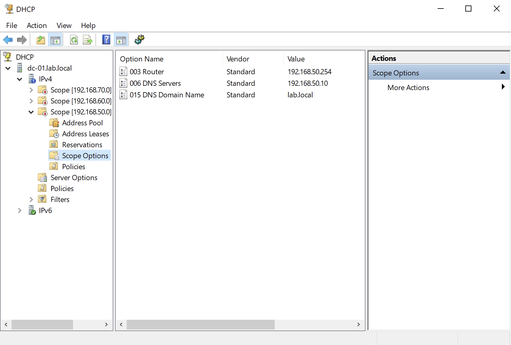
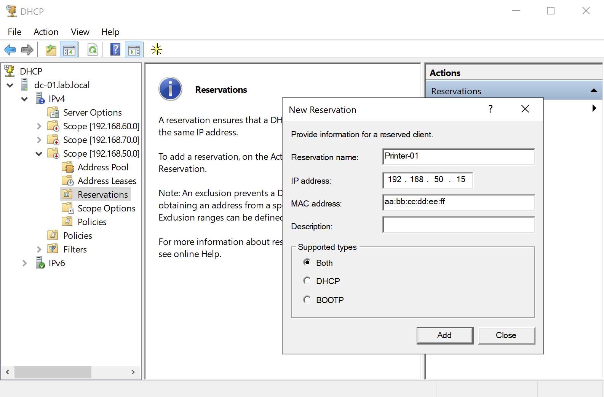
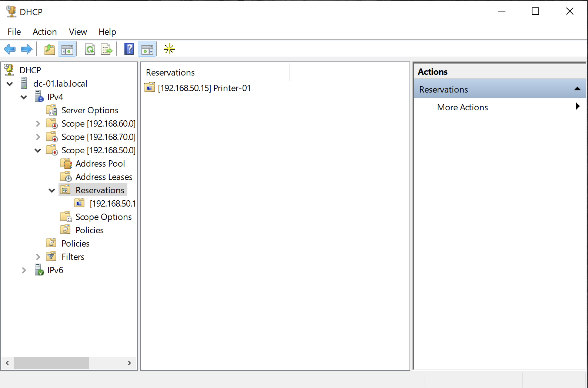
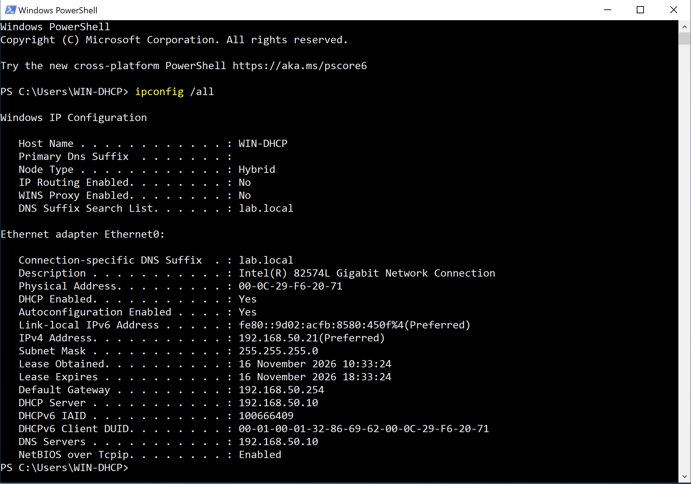
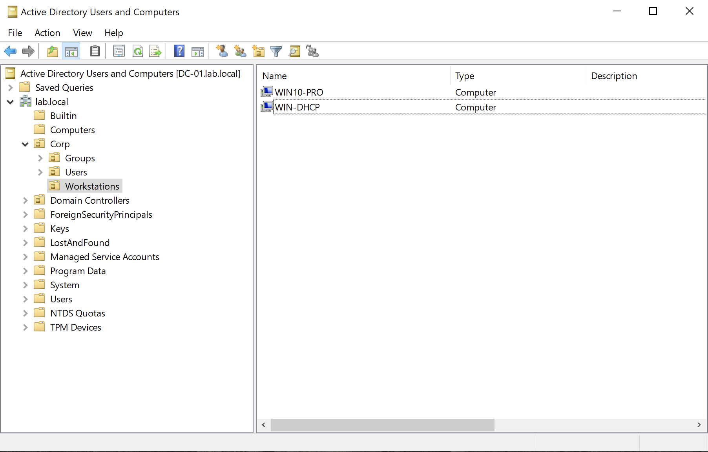

# Module 8: DHCP Configuration and Client Join (DCHP lease)
Install the DHCP role on `DC-01` to turn it into a DHCP server. 
Set separate scopes to simulate an enterprise network. 
Join another client machine `WIN-DHCP` to the domain by obtaining a reserved IP lease.

### Network infrastructure
| Scope | Subnet | Range | Exclusions | Lease Duration | Default Gateway | DNS Server |
|---|---|---|---|---|---|---|
| Users LAN | `192.168.50.0/24` | `192.168.50.10` – `192.168.50.200` | `192.168.50.10` – `192.168.50.20` (`DC-01` & `WIN-10-PRO`) | 8 hrs | `192.168.50.254` | `192.168.50.10` |
| Corporate Voice | `192.168.60.0/24` | `192.168.60.10` – `192.168.60.150` | `192.168.60.10` – `192.168.60.30` (Gateways / Call Managers) | 1 day | `192.168.60.254` | `192.168.50.10` |
| Guest Wi-Fi | `192.168.70.0/24` | `192.168.70.50` – `192.168.70.250` | `192.168.70.50` – `192.168.70.60` (Controllers / Portals) | 2 hrs | `192.168.70.254` | `192.168.50.10` |

## Overview

**0. IMPORTANT - VMware DHCP Configuration:** 
- On VMware, add a custom network interface (`Lab Network`) 
- Check `Provide address to this network via DHCP` to be able to fill out the `Subnet IP` field with `192.168.50.0`
- **Uncheck it right away** - this is a VMware quirk
- **Set the VMs to this network adapter** (the server and the two clients) so that they share the same subnet
> This is crucial to prevent VMware's own built-in DHCP service from leasing IP addressess instead of the desired DHCP service on the domain controller.

View Screenshot

 

  

___

**1. Install and activate the DHCP role on `DC-01`:**
- On the `Server Manager` click `Manage` → `Add Roles and Features`
- Follow the Wizard, then select the `DHCP Server` checkbox
- When asked, select the `DC-01.lab.local` destination server
- Once finished, reboot is unnecessary
- From the `Administrative Tools`, select `DHCP` → right click on `DC-01.lab.local` → `Authorize`

View Screenshots

 

  

  

  

___

**2. Create IPv4 scopes:**
- Expand `DC-01.lab.local` → right click on `IPv4` → `New Scope` → type `Users LAN`
- According to the [table](#network-infrastructure):
  - On the `IP Address Range` page, specify the desiderd range and the subnet mask
  - Add an exclusion and a lease duration
  - Repeat the steps for `Corporate Voice` and `Guest Wi-Fi`

View Screenshot

 

  

___

**3. Set scope options:**
- Expand `Scope [192.168.50.0] User LAN` → right click on `Scope Options` → `Configure Options`
- Check the following options:
  - `003 Router` - enter `192.168.50.254`
  - `006 DNS Servers` - enter `192.168.50.10`
  - `DNS Domain Name` - enter `lab.local`
- Do the same for the other two scopes (with the values from the [table](#network-infrastructure))

View Screenshot

 

  

___

**4. Reserve an IP for a printer:**
- Expand `Scope [192.168.50.0] User LAN` → right click on `Reservations` → `New Reservation`:
  - Reservation name: `Printer-01`
  - IP address: `192.168.50.15`
  - MAC address: any placeholder value

View Screenshots

 

  

  

---

**5. Join the `WIN-DHCP` client to the `lab.local` domain:**
- Within `WIN-DHCP`, run `ipconfig /all` to get networking info:
  - DNS Servers: `192.168.50.10`
  - DHCP Server: `192.198.50.10`
  - Default Gateway: `192.168.50.254`
  - IPv4 Address: should be within the `Users LAN` scope
- Change the computer name to `WIN-DHCP` and join it to `lab.local`
- On ADUC, move the `WIN-DHCP` computer object to the `Workstations` OU
> If everything was set up properly, the domain's DNS server will lease an IPv4 address to the client out of its scope of available addresses: `192.168.50.21` to `192.168.50.200`.

View Screenshots

 

  

  

