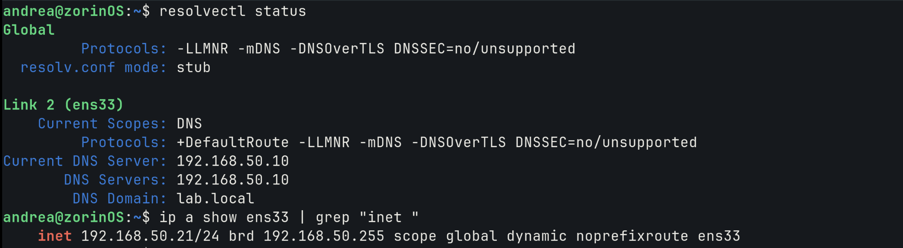
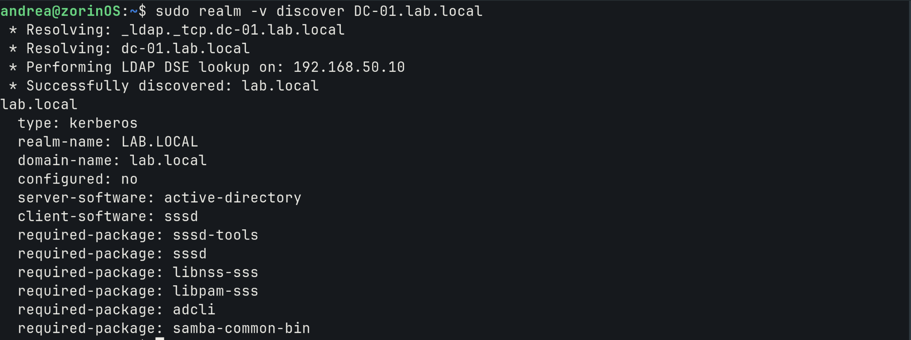
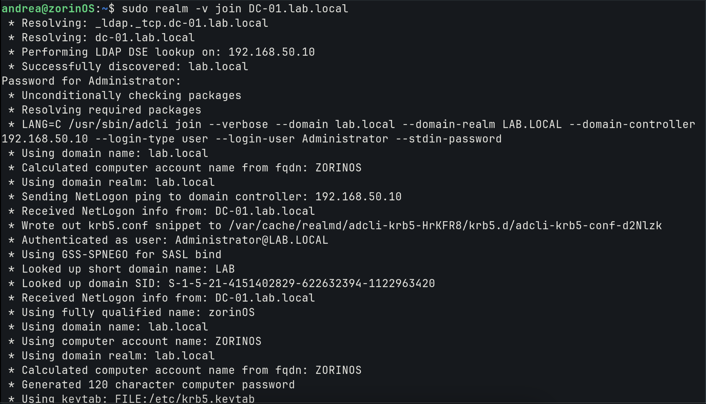
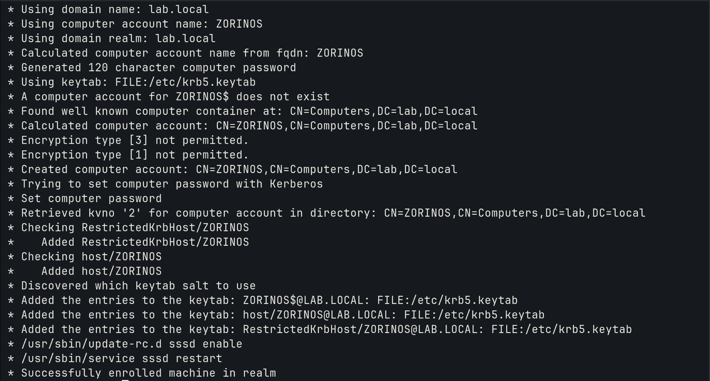
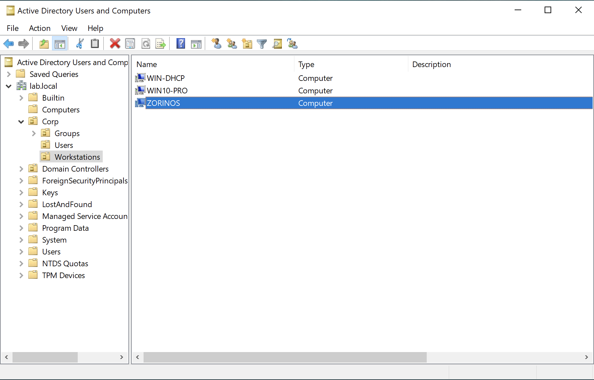
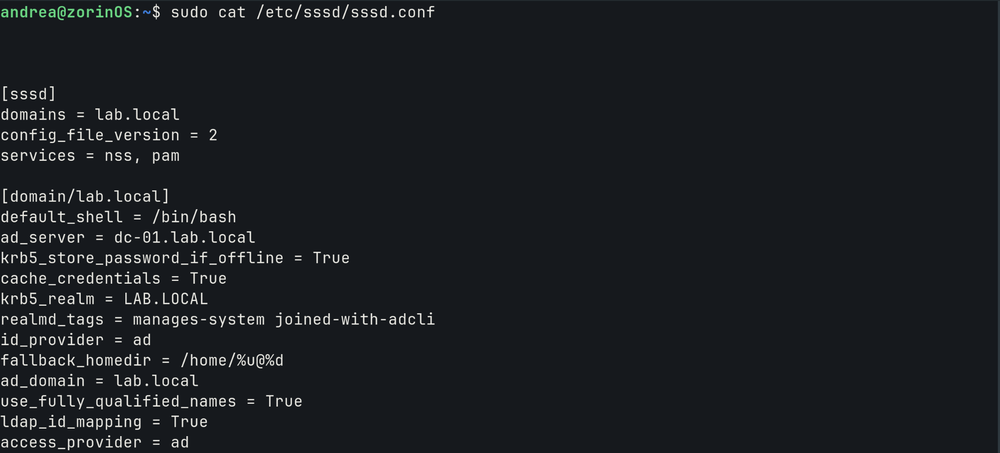
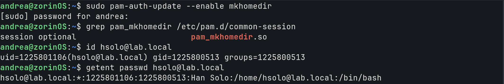
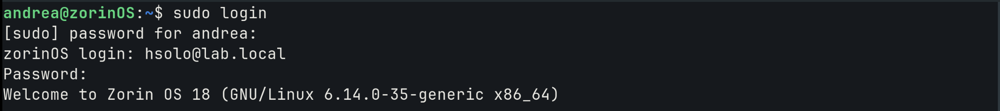
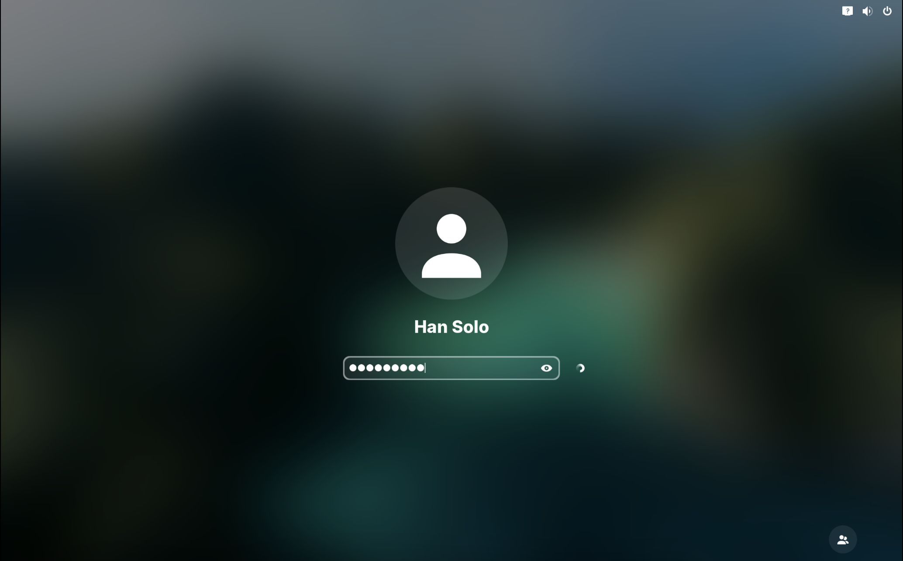

# Module 9: Linux Client Join (via SSSD and `realmd`)
Join a Linux VM (in this case the ZorinOS distro) to the domain using SSSD (System Security Services Daemon) and `realmd`.<br />

| Tool | Role |
|---|---|
| `sssd` | Authenticates users, resolves identities, and caches credentials |
| `realm` | Discovers domains and joins the machine to the domain |


## Overview

**1. Check DNS resolution and install Linux packages:**
- Before adding the ZorinOS VM to the domain, make sure it's on the same subnet (`192.168.50.0`)
- Run `resolvectl status`; it should show the DNS server as `192.168.50.10` and the DNS domain as `lab.local`
- Run `ip a show ens33 | grep "inet "` to check if ZorinOS is already getting an IPv4 address from the domain pool
- Install crucial Linux packages:
  ```sh
  sudo apt install sssd-ad sssd-tools realmd adcli
  ```

<details>
<summary>View Screenshot</summary>
<br />
<p align="center">
  
</p>
</details>

---

**2. Verify the domain is discoverable via DNS wtih `realmd`:**
  ```sh
  sudo realm -v discover DC-01.lab.local
  ```

<details>
<summary>View Screenshot</summary>
<br />
<p align="center">
  
</p>
</details>

---

**3. Join the domain with `realmd`:**
  ```sh
  sudo realm -v join DC-01.lab.local
  ```

<details>
<summary>View Screenshots</summary>
<br />
<p align="center">
  
</p>
<p align="center">
  
</p>
</details>

---

**4. Verify computer creation on AD:**
  - On ADUC, navigate to the default `Computers` container to verify that `ZORINOS` was succesfully joined
  - Move `ZORINOS` to the custom `Corp/Workstations` OU

<details>
<summary>View Screenshot</summary>
<br />
<p align="center">
  
</p>
</details>

---

**5. Check the SSSD config file:**
  - Run `sudo cat /etc/sssd/sssd.conf` to check that the information is correct
  > Important: the file must have permissions `0600` and ownership `root:root` or else SSSD won’t start

<details>
<summary>View Screenshot</summary>
<br />
<p align="center">
  
</p>
</details>

---

**6. Set up home directory with PAM and get domain user ID info:**
  - `realm` does not set up a home directory for the network users to get when they log on
  - Use PAM (Pluggable Authentication Module) to enable it:
    ```sh
    sudo pam-auth-update --enable mkhomedir
    ```
  - Check if the `pam_mkhomedir.so` session file exists:
    ```sh
    grep pam_mkhomedir /etc/common.d/common-session
    ```
    > A session file defines what happens when a user session starts and ends—such as opening a terminal, logging in over SSH, running `sudo`, or logging out.
  - Fetch info about an existing AD user (e.g. `hsolo`):
    ```sh
    id hsolo@lab.local
    getent passwd hsolo@lab.local
    ```

<details>
<summary>View Screenshot</summary>
<br />
<p align="center">
  
</p>
</details>

___

**7. Log in to ZorinOS with an AD user:**
  - Log in with `hsolo` from the terminal with `sudo login`
  - Log in with `hsolo` from the ZorinOS lockscreen

<details>
<summary>View Screenshots</summary>
<br />
<p align="center">
  
</p>
<p align="center">
  
</p>
</details>

---